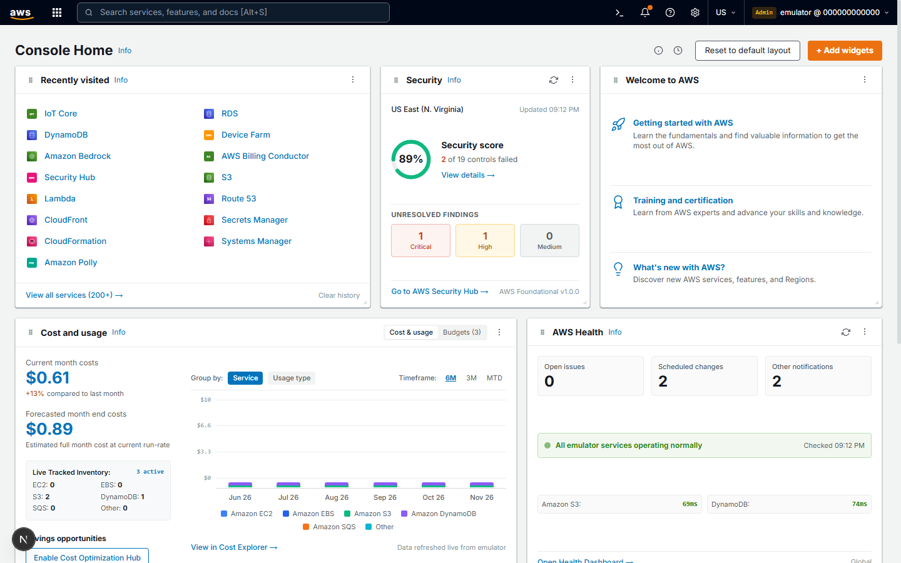

# AWS Emulator Console UI (`-aws-emulator-ui`)

A lightweight, local, pixel-perfect **AWS Management Console Web UI** designed specifically for the official [**AWS Emulator (`aws/aws-emulator`)**](https://github.com/aws/aws-emulator).

Built with **Next.js 16 (App Router)**, **TypeScript**, **Tailwind CSS**, and **AWS SDK v3**.



---

## Why This Project?

The official [AWS Emulator](https://github.com/aws/aws-emulator) is a local AWS API engine released by AWS for building and testing cloud workflows locally without incurring cloud costs. However, **the official AWS Emulator has no graphical user interface (GUI)** — it only provides an HTTPS API endpoint (`https://127.0.0.1:9297`) accessed through the AWS CLI or SDKs.

**`-aws-emulator-ui` provides the missing full-featured Management Console GUI**:
- **Pixel-perfect match** to the real AWS Console (dark `#000716` header, Cloudscape cards, official architecture icons, breadcrumbs, and collapsible sidebars).
- **Interactive service managers** for **S3**, **SQS**, **DynamoDB**, and **IAM**.
- **Services Catalog (`/services`)** index covering 26+ AWS cloud services.
- **Zero cloud credentials or costs required** — connects directly to your local emulator over HTTPS.

---

## Architecture

```
+-------------------------------------------------------------+
|                  Browser (Developer)                        |
|               http://127.0.0.1:3000                         |
+------------------------------+------------------------------+
                               |
                               | (React Server Actions / Pages)
                               v
+-------------------------------------------------------------+
|           Next.js 16 Console Web App (Node.js)              |
|   - Runs on 127.0.0.1:3000                                  |
|   - Uses AWS SDK v3 (S3, SQS, DynamoDB, IAM, STS)           |
|   - Auto-trusts Emulator CA cert via NODE_EXTRA_CA_CERTS    |
|   - Loads credentials from ~/.aws/emulator/9297/            |
+------------------------------+------------------------------+
                               |
                               | HTTPS (Port 9297)
                               v
+-------------------------------------------------------------+
|         Official AWS Emulator (Docker Container)            |
|   - Repository: https://github.com/aws/aws-emulator         |
|   - Listening on: 127.0.0.1:9297                            |
|   - Emulates S3, SQS, DynamoDB, IAM, and STS in memory      |
|   - Auto-generates CA certs and credentials to:             |
|     ~/.aws/emulator/9297/ca.pem                             |
|     ~/.aws/emulator/9297/emulator_credentials               |
|     ~/.aws/emulator/9297/config                             |
+-------------------------------------------------------------+
```

---

## Complete From-Scratch Setup Guide

Follow these steps to set up the **AWS Emulator** and the **Console UI** on your PC.

---

### Step 1: Install Docker
Make sure **Docker Desktop** (or Docker inside WSL 2 on Windows, or Docker Engine on Linux/macOS) is installed and running.

---

### Step 2: Clone This Repository
```bash
git clone https://github.com/Shubham-Bhayaje/-aws-emulator-ui.git
cd -aws-emulator-ui
```

This repository includes:
- `Dockerfile.emulator` — Ready-to-build Dockerfile for the official AWS Emulator RPM package.
- `scripts/emulator.sh` — Helper script to start, stop, and inspect the emulator with one command.
- The complete Next.js AWS Console UI web app.

---

### Step 3: Start the AWS Emulator

You can start the emulator using either the **helper script**, **Windows PowerShell**, or **WSL / Linux bash**.

#### Option A: Using the Helper Script (WSL / Linux / macOS)
```bash
# Make script executable (first time only)
chmod +x ./scripts/emulator.sh

# Build (first time only) and start the emulator in the background
./scripts/emulator.sh start
```

#### Option B: Using Windows PowerShell (Native Windows)
```powershell
# 1. Create directory for certificates & credentials
New-Item -ItemType Directory -Force "$env:USERPROFILE\.aws\emulator"

# 2. Build the Docker image
docker build -t aws-emulator -f Dockerfile.emulator .

# 3. Run the container
$port = 9297
docker run -d --rm --memory=2g --memory-swap=2g `
  -p "127.0.0.1:${port}:${port}" `
  -v "$env:USERPROFILE\.aws\emulator:/home/emulator/.aws/emulator" `
  aws-emulator -p $port --telemetry off
```

#### Option C: Using Bash (WSL / Linux)
```bash
# 1. Create directory
mkdir -p ~/.aws/emulator

# 2. Build the Docker image
docker build -t aws-emulator -f Dockerfile.emulator .

# 3. Run the container in the background
docker run -d --rm --memory=2g --memory-swap=2g \
  -p 127.0.0.1:9297:9297 \
  --user "$(id -u):$(id -g)" \
  -e HOME="$HOME" \
  -v "$HOME/.aws/emulator:$HOME/.aws/emulator" \
  aws-emulator -p 9297 --telemetry off
```

---

### Step 4: Verify the Emulator is Running

Check that the container is active:
```bash
docker ps --filter "name=aws-emulator"
```

Verify that the emulator automatically created its TLS certificate and credentials:
```bash
# In WSL / Linux:
ls -la ~/.aws/emulator/9297/

# In PowerShell:
Get-ChildItem "$env:USERPROFILE\.aws\emulator\9297\"
```
You should see:
- `ca.pem` — TLS self-signed root certificate.
- `emulator_credentials` — AWS Access Key ID and Secret Access Key.
- `config` — Region (`us-east-1`) and endpoint (`https://127.0.0.1:9297`).

#### (Optional) Test with AWS CLI:
**In WSL / Bash:**
```bash
export AWS_SHARED_CREDENTIALS_FILE=~/.aws/emulator/9297/emulator_credentials
export AWS_CONFIG_FILE=~/.aws/emulator/9297/config
export AWS_CA_BUNDLE=~/.aws/emulator/9297/ca.pem
export AWS_EC2_METADATA_DISABLED=true

aws sts get-caller-identity
```

**In PowerShell:**
```powershell
$env:AWS_SHARED_CREDENTIALS_FILE = "$env:USERPROFILE\.aws\emulator\9297\emulator_credentials"
$env:AWS_CONFIG_FILE = "$env:USERPROFILE\.aws\emulator\9297\config"
$env:AWS_CA_BUNDLE = "$env:USERPROFILE\.aws\emulator\9297\ca.pem"
$env:AWS_EC2_METADATA_DISABLED = "true"

aws sts get-caller-identity
```
You will receive the emulator's fixed account ID `000000000000`:
```json
{
    "UserId": "AIDAH5I7GEMO7ADXNFAZU",
    "Account": "000000000000",
    "Arn": "arn:aws:iam::000000000000:user/emulator"
}
```

---

### Step 5: Start the Console UI

1. Install project dependencies (requires Node.js v20+):
   ```bash
   npm install
   ```

2. Start the development server:
   ```bash
   npm run dev
   ```

   > **Note:** The `npm run dev` script automatically binds to `127.0.0.1` and passes `NODE_EXTRA_CA_CERTS`, `AWS_SHARED_CREDENTIALS_FILE`, and `AWS_CONFIG_FILE` from your emulator directory.

3. Open your browser:
   👉 [**http://127.0.0.1:3000**](http://127.0.0.1:3000)

---

## Supported Services & Capabilities

| Service | Route | Key Features |
| :--- | :--- | :--- |
| **Console Home** | `/` | Recently visited services widget (localStorage), official service icons, Welcome widget. |
| **All Services** | `/services` | Categorized directory of 26+ AWS services with search filters and category pills. |
| **Amazon S3** | `/s3` | Create buckets (Block Public Access, Versioning), prefix folder navigation, file drag-and-drop upload, file download, and delete. |
| **Amazon SQS** | `/sqs` | Create Standard & FIFO queues, send messages, live poll messages with receipt handles, and purge queues. |
| **Amazon DynamoDB** | `/dynamodb` | Create tables (partition key & optional sort key, on-demand/provisioned capacity), dynamic attribute item explorer, and dual-mode **Form & JSON Item Editor**. |
| **AWS IAM** | `/iam` | IAM Dashboard (metric tiles, sign-in URL), Users (attach/detach policies), Roles (service trust policies), Policies catalog, and **Permission Inspector** (visual statement breakdown + JSON viewer). |

---

## Helpful Helper Script Commands

If you use `./scripts/emulator.sh`:
```bash
./scripts/emulator.sh start   # Builds Docker image (if missing) & runs in background
./scripts/emulator.sh status  # Checks if emulator container is running
./scripts/emulator.sh env     # Prints the export commands for AWS CLI
./scripts/emulator.sh stop    # Stops the emulator container
```

---

## Important Things to Know

1. **In-Memory Storage**:  
   The official AWS Emulator keeps emulated resources in memory. When you stop the container (`docker stop aws-emulator` or `./scripts/emulator.sh stop`), all emulated buckets, queues, tables, and users are reset.
2. **Local Security (`127.0.0.1`)**:  
   The emulator and UI bind exclusively to `127.0.0.1` (localhost) to prevent exposure on your local network.
3. **Self-Signed Certificates**:  
   Because the emulator communicates over HTTPS with a self-signed root cert, Node.js needs `NODE_EXTRA_CA_CERTS` to establish TLS trust. The `npm run dev` command handles this out of the box.
