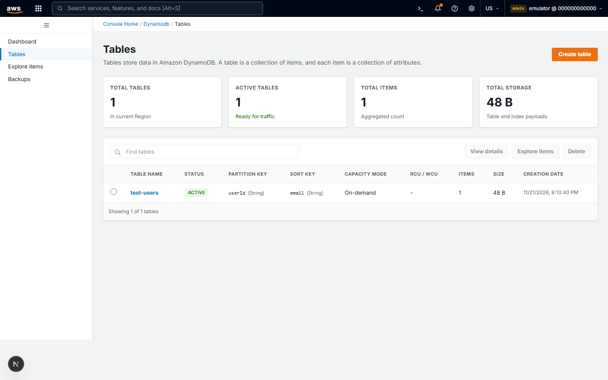
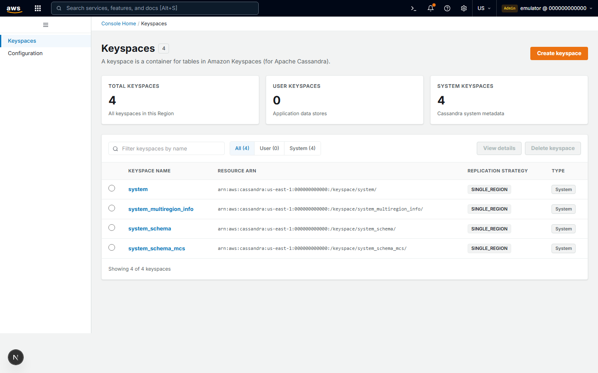
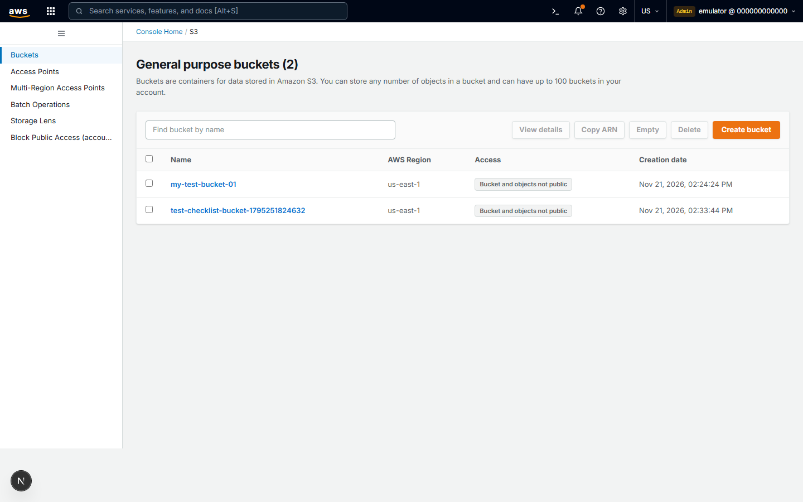

# AWS Emulator UI

An open-source web UI and interactive dashboard for the official **AWS Emulator**, bringing an authentic AWS Management Console experience to your local development environment.

[](LICENSE)
[](https://nextjs.org)
[](https://react.dev)
[](https://aws.amazon.com/sdk-for-javascript/)

> **Disclaimer:** **AWS Emulator UI is an independent, unofficial community project.** It is not affiliated with, maintained by, or endorsed by Amazon Web Services (AWS) or Amazon.com, Inc. The official headless emulator is hosted at [aws/aws-emulator](https://github.com/aws/aws-emulator).

---

## Overview

The official [AWS Emulator](https://github.com/aws/aws-emulator) provides a fast, lightweight local AWS API engine for development and testing. However, it is strictly headless (`https://127.0.0.1:9297`).

**AWS Emulator UI** bridges this gap by delivering a local management console that replicates the look, feel, and workflows of the real AWS Management Console. Developers and learners can visually manage buckets, inspect DynamoDB items, poll SQS queues, manage IAM policies, request SSL/TLS certificates, and configure KMS encryption keys entirely on localhost without cloud bills or internet dependencies.


---

## Console Interface Preview

| Console Home Dashboard | Amazon DynamoDB Tables |
| :---: | :---: |
| [](docs/images/console-home.png)<br><sub>Customizable 12-column widget grid with health diagnostics, Security Hub audit, and cost trends</sub> | [](docs/images/dynamodb-tables.png)<br><sub>Global DynamoDB tables inventory with capacity modes, partition/sort keys, and item explorer</sub> |

| Amazon Keyspaces (Apache Cassandra) | Amazon S3 Buckets |
| :---: | :---: |
| [](docs/images/keyspaces-overview.png)<br><sub>Managed Cassandra keyspaces, dynamic CQL schema builder, and multi-region replication</sub> | [](docs/images/s3-buckets.png)<br><sub>Buckets inventory with multi-level folder navigation, KMS encryption, and public access blocks</sub> |

| AWS Key Management Service (KMS) | Amazon SQS Queues |
| :---: | :---: |
| [](docs/images/kms-keys.png)<br><sub>Customer & AWS managed keys, key rotation, policy editor, and live cryptographic playground</sub> | [](docs/images/sqs-queues.png)<br><sub>Standard & FIFO queues, live polling message inspector, and dead-letter queue redrive</sub> |

---

## Quickstart

### 1. Prerequisites
- **Docker Desktop** (Windows / macOS) or **Docker Engine** (Linux / WSL)
- **Node.js** (v20+ recommended) and **npm**

### 2. Start the AWS Emulator
Run the official emulator on port `9297`:

```bash
# Using the bundled script (Linux / macOS / WSL)
./scripts/emulator.sh start

# Or via Docker on Windows PowerShell
New-Item -ItemType Directory -Force "$env:USERPROFILE\.aws\emulator"
docker run -d --rm -p 127.0.0.1:9297:9297 -v "$env:USERPROFILE\.aws\emulator:/home/emulator/.aws/emulator" aws-emulator -p 9297 --telemetry off
```

### 3. Launch the Console UI
```bash
git clone https://github.com/Shubham-Bhayaje/aws-emulator-ui.git
cd aws-emulator-ui
npm install
npm run dev
```

Open your browser to: **[http://localhost:3000](http://localhost:3000)**

---

## Supported Services

| Service | Category | Status | Guide | Date Added |
| :--- | :--- | :--- | :--- | :--- |
| **AWS Management Console Home** | General | Built | [Console Home Guide](docs/Console%20Home.md) | 2026-11-21 |
| **AWS Account Management** | Management & Governance | Built | [Account Management Guide](docs/Account%20Management.md) | 2026-11-20 |
| **AWS AppConfig** | Management & Governance | Built | [AppConfig Guide](docs/AppConfig.md) | 2026-11-22 |
| **AWS Certificate Manager (ACM)** | Security, Identity, & Compliance | Built | [ACM Guide](docs/ACM.md) | 2026-11-21 |
| **AWS Cloud Map** | Networking & Content Delivery | Built | [Cloud Map Guide](docs/Cloud%20Map.md) | 2026-11-22 |
| **AWS CloudHSM** | Security, Identity, & Compliance | Built | [CloudHSM Guide](docs/CloudHSM.md) | 2026-11-21 |
| **AWS Directory Service** | Security, Identity, & Compliance | Built | [Directory Service Guide](docs/Directory%20Service.md) | 2026-11-21 |
| **AWS Key Management Service (KMS)** | Security, Identity, & Compliance | Built | [KMS Guide](docs/KMS.md) | 2026-11-21 |
| **AWS Private Certificate Authority (Private CA)** | Security, Identity, & Compliance | Built | [Private CA Guide](docs/Private%20CA.md) | 2026-11-21 |
| **AWS Secrets Manager** | Security, Identity, & Compliance | Built | [Secrets Manager Guide](docs/Secrets%20Manager.md) | 2026-11-21 |
| **AWS Systems Manager Parameter Store** | Management & Governance | Built | [Parameter Store Guide](docs/SSM%20Parameter%20Store.md) | 2026-11-21 |
| **Amazon CloudWatch Logs** | Management & Governance | Built | [CloudWatch Logs Guide](docs/CloudWatch%20Logs.md) | 2026-11-21 |
| **Amazon DynamoDB** | Database | Built | [DynamoDB Guide](docs/DynamoDB.md) | 2026-11-21 |
| **Amazon Elastic Container Registry (ECR)** | Containers | Built | [ECR Guide](docs/ECR.md) | 2026-11-22 |
| **Amazon Location Service** | Front-End Web & Mobile | Built | [Location Service Guide](docs/Location%20Service.md) | 2026-11-22 |
| **Amazon Kinesis Data Streams** | Analytics | Built | [Kinesis Guide](docs/Kinesis%20Data%20Streams.md) | 2026-11-21 |
| **Amazon Keyspaces** | Database | Built | [Keyspaces Guide](docs/Keyspaces.md) | 2026-11-21 |
| **Amazon Timestream** | Database | Built | [Timestream Guide](docs/Timestream.md) | 2026-11-21 |
| **Amazon S3** | Storage | Built | [S3 Guide](docs/S3.md) | 2026-11-21 |
| **Amazon S3 Glacier** | Storage | Built | [S3 Glacier Guide](docs/S3%20Glacier.md) | 2026-11-21 |
| **Amazon Simple Email Service (SES)** | Business Applications | Built | [SES Guide](docs/SES.md) | 2026-11-22 |
| **Amazon SNS** | Application Integration | Built | [SNS Guide](docs/SNS.md) | 2026-11-21 |
| **Amazon SQS** | Application Integration | Built | [SQS Guide](docs/SQS.md) | 2026-11-21 |
| **Amazon Virtual Private Cloud (VPC)** | Networking & Content Delivery | Built | [VPC Guide](docs/VPC.md) | 2026-11-22 |
| **AWS Site-to-Site VPN** | Networking & Content Delivery | Built | [Site-to-Site VPN Guide](docs/SITE_TO_SITE_VPN.md) | 2026-11-22 |
| **AWS Transit Gateway** | Networking & Content Delivery | Built | [Transit Gateway Guide](docs/TRANSIT_GATEWAY.md) | 2026-11-22 |
| **AWS IAM** | Security, Identity, & Compliance | Built | [Console](docs/README.md) | Initial |
| **AWS Resource Access Manager (RAM)** | Security, Identity, & Compliance | Built | [Console](docs/README.md) | 2026-11-20 |
| **AWS Resource Explorer** | Management & Governance | Built | [Resource Explorer Guide](docs/Resource%20Explorer.md) | 2026-11-22 |
| **AWS Resource Groups & Tag Editor** | Management & Governance | Built | [Resource Groups Guide](docs/Resource%20Groups%20Tagging%20API.md) | 2026-11-20 |
| **AWS Service Quotas** | Management & Governance | Built | [Service Quotas Guide](docs/Service%20Quotas.md) | 2026-11-20 |

---

## Key Features

- **Core Storage & Database**:
  - **Amazon S3**: Scalable cloud object storage, global bucket inventory, multi-level folder prefix navigation, multi-file drag-and-drop uploader, versioning lifecycle, default encryption with AWS KMS key integration, granular Block Public Access settings, bucket policy editor, static website hosting, and lifecycle transition rules.
  - **Amazon S3 Glacier**: Low-cost data archiving and cold storage, global vaults inventory, metric summary cards, 4-step Create Vault Wizard with optional SNS event notifications and resource policy, comprehensive vault details with 7 interactive tabs (Vault details, Archives, Jobs, Permissions, Notifications, Vault Lock, Tags), archive file upload with SHA256 tree hash calculation, asynchronous inventory and archive retrieval jobs with retrieval tier selection (Standard, Expedited, Bulk), job output inspection, archive deletion, and account data retrieval policies view.
  - **Amazon DynamoDB**: Fast and flexible NoSQL database service, global tables inventory with Region summary metrics (Total tables, Active tables, Total items, Total storage), search filter, Table creation wizard with partition key, sort key, On-demand vs Provisioned capacity modes, live KMS Customer Managed Key dropdown, deletion protection, comprehensive table details with 8 interactive tabs (Overview, Explore items, Indexes with GSI and LSI, Monitor with operational CloudWatch charts, Additional settings with Time to Live (TTL) and Point-in-time recovery (PITR), Backups with on-demand snapshot creation and restore workflows, Exports and streams with DynamoDB Streams toggle, Lambda triggers, S3 export, and Amazon Kinesis data stream destination with live stream picker, and Tags), item editor in both dynamic Form and raw JSON views, universal Explore items page, and centralized Backups inventory.
  - **Amazon Keyspaces (for Apache Cassandra)**: Scalable, highly available, and managed Apache Cassandra-compatible database service, global keyspaces inventory with summary metric cards (Total, User, System), User vs System keyspace toggle, Create Keyspace wizard with Single-Region and Multi-Region replication, keyspace details view with active Cassandra tables inventory and Tags, Create Table wizard with interactive dynamic Cassandra column schema builder supporting all CQL data types, partition key (HASH) and clustering column (ASC/DESC) designations, On-demand vs Provisioned capacity modes, live KMS Customer Managed Key dropdown, Point-in-time recovery (PITR), and default Time to Live (TTL), table details view with Overview, Edit settings (append new schema columns, modify throughput capacity, update PITR and TTL), and Tags tabs, table deletion protection, and Configuration page detailing regional TLS 1.2+ endpoints (port 9142) and service quotas.
  - **Amazon Timestream**: Fast, scalable, and serverless time series database service for IoT and operational metrics, global databases inventory with Region summary metrics (Total Databases, Total Tables, Default KMS Keys, Customer KMS Keys), name search filter, Create Database wizard (Standard vs Sample database) with live KMS customer managed key dropdown, database details with tables inventory and configuration, Create Table wizard with dual storage tiering (Memory store retention in hours/days and Magnetic store retention in days/months/years) and late-arriving magnetic store writes toggle, comprehensive table details with storage tiering breakdown, interactive live Write Records ingestion utility executing real time-series data writes via AWS SDK, Monitoring tab, SQL query editor with sample queries, and InfluxDB instances overview.
  - **Amazon SQS**: Scalable message queuing service for microservices, global queues inventory with metric summary cards (Total Queues, Messages Available, Messages In Flight, Messages Delayed), Standard and FIFO queues creation wizard with content-based deduplication and live KMS customer managed key dropdown, comprehensive queue details with 10 interactive tabs (Details, Send and receive messages with live polling and message inspector, Monitoring, Encryption, Access policy, Redrive policy, Dead-letter queue redrive utility, Tags, SNS subscriptions with live topic modal, and Lambda triggers with real function selection), message body modal inspector, and single/bulk queue purge and deletion.
  - **Amazon SNS**: Fully managed pub/sub messaging service, global topics inventory with summary metric cards (Total topics, Standard topics, FIFO topics, Subscriptions), Standard and FIFO topic creation with live KMS key dropdown, topic edit and deletion, comprehensive topic details with 7 interactive tabs (Details, Subscriptions, Encryption, Access policy, Delivery policy HTTP/S, Delivery status logging, Tags), live message publisher with custom JSON payload and message attributes, subscriptions inventory table, create subscription wizard with live SQS queue and Lambda function dropdowns, subscription details with filter policy and DLQ redrive, and mobile push notifications and SMS messaging overview views.

- **Analytics & Real-Time Streaming**:
  - **Amazon Kinesis Data Streams**: Massively scalable and durable real-time streaming data service, global streams inventory with Region summary metrics (Total Data Streams, Open Shards, On-Demand Streams, Encrypted Streams), name search filter, Create Data Stream wizard with On-demand vs Provisioned capacity modes, interactive shard capacity estimator calculator, data retention period (24 to 8,760 hours / up to 365 days), live KMS customer managed key dropdown, comprehensive stream details with 6 interactive tabs (Configuration, Shards inventory table with hash key ranges, Data viewer with interactive live PutRecord ingestion utility and GetRecords stream browser supporting Trim Horizon / Latest / Sequence Number iterators, Enhanced fan-out consumers registration with dedicated 2 MB/sec throughput per shard, Monitoring with shard-level metrics toggles, and Tags), edit capacity mode and resharding, edit retention period, edit server-side encryption, and integrated DynamoDB streaming destinations.

- **Business Applications & Messaging**:
  - **Amazon Simple Email Service (SES)**: Fully managed cloud email service, Account dashboard with 24-hour send quota progress bar, sending rate, sandbox/production status banner, deliverability reputation gauges (bounce and complaint rates), Verified identities inventory with type filter (All, Email address, Domain), Create identity wizard with Easy DKIM (RSA 2048-bit) and custom MAIL FROM domain alignment, comprehensive identity details view with 5 interactive tabs (Overview & verification token, Authentication with 3 DKIM CNAME records, Notification topics linking live Amazon SNS topics for Bounces/Complaints/Deliveries, Configuration sets assignment, and Identity policies with JSON editor), Configuration sets inventory and creation wizard, Email templates manager with HTML and plain text editors and live rendered preview modal, Suppression list manager with add/remove actions, SMTP settings with endpoint ports, TLS requirements, and dedicated IAM SMTP credentials generator with standard RFC 2104 HMAC-SHA256 password derivation and CSV download, and Send Test Email utility supporting mailbox simulator scenarios (Success, Hard bounce, Complaint).

- **Containers**:
  - **Amazon Elastic Container Registry (ECR)**: Fully managed Docker and OCI container image registry, global private repositories inventory with Region summary metrics (Total repositories, Immutable tags, Scan on push, KMS encrypted), name search filter, Create repository wizard with visibility settings (Private vs Public), tag immutability toggle (Mutable vs Immutable), automated vulnerability scan on push toggle, KMS customer managed key integration, and resource tags editor, comprehensive repository detail view with 4 interactive tabs (Images table with tag badges, size, push timestamp, scan status, and sha256 digests; Permissions with resource policy JSON editor; Lifecycle policy with automated age and count-based image expiration rules; Tags manager), View Push Commands modal with step-by-step Docker CLI authentication and build/tag/push commands for macOS/Linux and Windows, Public Repositories showcase gallery, and Registry Settings view managing vulnerability scanning configuration and pull through cache rules (Amazon ECR Public, Docker Hub, Quay, GitHub Container Registry).

- **Geospatial & Location**:
  - **Amazon Location Service**: Fully managed geospatial platform matching AWS Amazon Location Service, resource overview dashboard with real-time inventory counts (Maps, Trackers, Geofence Collections, Route Calculators, Place Indexes, API Keys), interactive Maps manager with vector and raster basemap styles from Esri, HERE, and Open Data, Create Map wizard with visual style selector cards, Map detail view featuring an interactive SVG/Canvas viewport simulation with pan/zoom controls and MapLibre GL JS embed code generator, Trackers manager with position filtering strategies (Time-based, Distance-based, Accuracy-based) and KMS encryption, Tracker detail view with live device position ingestion simulator (BatchUpdateDevicePosition) and consumer geofence collection linking, Geofence Collections manager with Circle and Polygon boundary support (PutGeofence) and interactive perimeter coordinate validation, Route Calculators with road network providers (Esri, HERE) and route calculation playground, Place Indexes view with emulator compatibility status banner, and API Keys view.

- **Networking & Content Delivery**:
  - **Amazon Virtual Private Cloud (Amazon VPC)**: Complete implementation and authentic replica of the Amazon VPC Management Console with VPC Dashboard featuring 11 live resource metric cards; Your VPCs manager with "VPC only" and "VPC and more" visual multi-tier architecture generator, secondary IPv4 CIDR blocks, DNS hostnames and DNS resolution toggles; Subnets manager across multiple Availability Zones with auto-assign public IPv4 address toggling; Route Tables manager with Routes tab (local, Internet Gateway, NAT Gateway targets) and explicit Subnet Associations tab; Internet Gateways manager with one-click VPC attach and detach workflows; NAT Gateways manager with Public and Private connectivity types, elastic IP allocation selection, and instant Elastic IP allocation shortcut; Security Groups manager with stateful inbound/outbound firewall rules editor (HTTP, HTTPS, SSH, custom TCP/UDP) and delete rule actions; Network ACLs manager with stateless numbered rules evaluation (ALLOW/DENY actions) and subnet associations; Elastic IP Addresses manager with allocate, associate, disassociate, and release lifecycles; VPC Endpoints manager supporting Gateway endpoints (Amazon S3, Amazon DynamoDB) with automatic route table insertion and Interface endpoints (AWS PrivateLink) with subnet ENI selection; Peering Connections manager with inter-VPC connection requests, accept request, and reject request actions; and DHCP Option Sets manager with custom domain name, DNS servers (AmazonProvidedDNS), and VPC association workflows.
  - **AWS Site-to-Site VPN**: Secure encrypted hybrid connectivity linking on-premises corporate networks to Amazon VPC or AWS Transit Gateway; Customer Gateways manager with BGP ASN and static IP routing; Virtual Private Gateways manager with Amazon-side ASN (default 64512) and VPC attach/detach lifecycles; Site-to-Site VPN Connections manager with dual redundant IPsec tunnels, live telemetry, static CIDR routes manager, and sample router configuration downloads (Cisco Systems, Juniper Networks, Fortinet FortiGate, strongSwan); seamless target integration with both Virtual Private Gateways and Transit Gateways.
  - **AWS Transit Gateway**: Centralized regional network transit hub connecting Amazon VPCs and on-premises networks; Transit Gateways manager with creation wizard (Amazon-side ASN, VPN ECMP, DNS support, multicast, CIDR blocks), details view with attachments, route tables, and tags tabs; Transit Gateway Attachments manager with VPC attachments, per-AZ subnet selection, IPv6 and appliance mode support; Transit Gateway Route Tables manager with Associations, dynamic Propagations, static routes, and blackhole routes; full VPC Route Table target integration enabling routing into Transit Gateways directly from VPC subnets.
  - **AWS Cloud Map**: Fully managed cloud service discovery and resource registry matching AWS Cloud Map, resource overview dashboard with real-time inventory counts (Namespaces, Services, Registered Instances), Namespaces manager with type filter (HTTP, Private DNS, Public DNS), Create Namespace wizard supporting HTTP namespaces (API-only discovery), Private DNS namespaces with dynamic Amazon VPC association, and Public DNS namespaces, comprehensive namespace details view with Route 53 managed hosted zone status and child services table, Services manager with parent namespace filter, Create Service wizard with routing policies (Multivalue Answer vs Weighted routing), DNS record types (A, AAAA, SRV, CNAME with custom TTL), and custom health check failure threshold, comprehensive service details view with Instances management (IPv4, Port, and custom key-value attributes registration/deregistration), one-click custom health status toggle (`Set Healthy` / `Set Unhealthy`), and interactive Discover Instances (API Playground) executing live `DiscoverInstances` queries with attribute filtering against the AWS emulator.

- **Security, Identity, & Compliance**:
  - **AWS IAM**: Users, roles with trust policies, policy inspector with syntax-highlighted JSON documents.
  - **AWS KMS**: Customer & AWS managed keys, 5-step key creation wizard, key rotation, JSON policy editor, live cryptographic playground (Encrypt, Decrypt, GenerateDataKey).
  - **AWS Certificate Manager (ACM)**: Public/private certificate requests, 2-step wizard, DNS (Route 53 CNAME) validation, email validation, PEM certificate import, raw body viewer, tags.
  - **AWS CloudHSM**: Dedicated hardware security module clusters inside Amazon VPC, FIPS 140-2 Level 3 validation mode, multi-AZ HSM provisioning, cluster CSR export, initialization workflows, automated backup retention, and cluster safety teardown.
  - **AWS Directory Service**: Set up and manage Simple AD, AWS Managed Microsoft AD, and AD Connector directories in Amazon VPC, multi-AZ domain controller placement, Access URL alias configuration (`<alias>.awsapps.com`), Single Sign-On (SSO) toggle, manual and automated snapshot backups, administrative password reset (`Administrator`), resource tags, and trust relationship monitoring.
  - **AWS Private Certificate Authority (Private CA)**: Root and Subordinate CA creation wizard, CSR export, automated self-signed root activation or external cert import, private certificate issuance with X.509 templates, serial-based certificate revocation, S3 CRL distribution configuration, IAM resource-based policy editor, and 7-30 day soft-deletion retention with one-click restore.
  - **AWS Secrets Manager**: Store database/application credentials, 4-step wizard, key/value and plaintext editors, AWS KMS envelope encryption, version staging labels (AWSCURRENT, AWSPREVIOUS), resource policies, and scheduled 7-30 day recovery deletion.
  - **AWS RAM**: Resource shares, resource associations, cross-account sharing workflows.

- **Management & Governance**:
  - **Amazon CloudWatch Logs**: Centralized cloud logging service, global log groups inventory with Region summary metrics (Total Log Groups, Stored Bytes, Metric Filters, Infrequent Access), name search filter, Create Log Group modal (Standard vs Infrequent Access, retention setting from 1 day to 10 years, and live KMS customer managed key dropdown), comprehensive log group details with 5 interactive tabs (Log streams inventory with multi-select and deletion, Search log group with live time-range event filtering and pattern search, Metric filters creating CloudWatch metrics from log patterns, Subscription filters streaming records into Amazon Kinesis and AWS Lambda, and Tags manager), dedicated log stream terminal viewer with Put log event ingestion simulator, Live Tail real-time event streaming terminal with auto-scrolling, and CloudWatch Logs Insights query runner with sample templates.
  - **AWS Systems Manager Parameter Store**: Secure, hierarchical storage for configuration data and secrets, multi-tier support (Standard vs Advanced), String/StringList/SecureString data types, KMS encryption with live reveal/decrypt controls, full version history with staging labels, tags management, and bulk deletion.
  - **AWS Account Management**: Display name, primary/alternate contacts, 32-region opt-in manager, account closure checklist.
  - **AWS Resource Groups & Tag Editor**: Global multi-service resource discovery, bulk tagging/untagging with diff review, tag autocompletion, query-based resource groups.
  - **AWS Resource Explorer**: Fast, multi-region resource search and discovery service matching AWS Resource Explorer (Resource Explorer 2), Resource Search page with interactive query search bar and syntax guide, quick filter chips for popular services (s3, dynamodb, sns, sqs, kms, ec2, lambda, iam), view selector, matching resources inventory with deep-link navigation and quick ARN copy, Views management table with default indicator and deletion safety modal, Create View wizard with custom filter expressions and tag inclusion toggle, View Details view with inline filter and tag editing, and Settings page for regional and aggregator index management and default view assignment.
  - **AWS Service Quotas**: 200+ services catalog, default vs applied comparison, quota increase requests, org templates.

- **Platform Tools & User Experience**:
  - **AWS CloudShell Terminal (`>_`)**: Built-in CLI drawer running real commands directly against the emulator.
  - **Active Identity Switcher**: Switch between Administrator, IAM users, and Assumed Roles with local policy evaluation.
  - **Global Service Search (`Alt + S`)**: Command palette indexing 200+ AWS services with instant jump navigation.
  - **Console Home Dashboard**: Authentic 12-column responsive widget grid with "+ Add widgets" customization modal drawer, "Reset to default layout", Recently visited 2-column launcher with real AWS vector icons, Security Hub compliance posture score with live emulator audit across IAM, S3, SQS, DynamoDB, and Glacier, AWS Health diagnostic latency checks across 7 live emulator services, Cost and usage stacked trend chart with functional AWS Budgets manager, Welcome to AWS onboarding guide, Build a solution rapid bootstrapping cards, and Explore AWS training and architecture center.

---

## Action Support Matrix

<details>
<summary><strong>Click to expand full API operations verification details</strong></summary>

### AWS Management Console Home
| Action / Capability | Underlying CLI / Endpoint | Support Status | Console Implementation |
| :--- | :--- | :--- | :--- |
| `GetCallerIdentity` | `aws sts get-caller-identity` | Supported | Identity banner in header and health diagnostics |
| `RecentlyVisited` | `localStorage` | Supported | 2-column launcher with authentic vector icons & hover dismissal |
| `AddWidgets` | `localStorage` | Supported | Customization modal with active and disabled service badges |
| `ResetDefaultLayout` | `localStorage` | Supported | Restores canonical AWS 5-widget grid arrangement |
| `SecurityHubAudit` | `iam:ListUsers`, `s3:ListBuckets`, `sqs:ListQueues`, `dynamodb:ListTables` | Supported | Posture score gauge, live scan spinner, and findings modal |
| `HealthDiagnostics` | `s3`, `dynamodb`, `sqs`, `sns`, `glacier`, `iam`, `sts` | Supported | Live round-trip latency (ms) diagnostics table with refresh action |
| `CostAndUsageBilling` | Emulator resource inventory | Supported | Month-to-date spend, forecast, service stacked chart, Budgets |
| `BuildASolution` | Service creation routes | Supported | Quick-launch cards for EC2, S3, DynamoDB, SQS, SNS, Glacier |
| `ExploreAWS` | Documentation & training links | Supported | Tutorials, Free Tier, Architecture Center, Skill Builder |
| `CloudWatchAlarms` | `cloudwatch:DescribeAlarms` | Unbuilt | Disabled with badge "Available after CloudWatch is built" |
| `Applications` | `servicecatalog-appregistry` | Unbuilt | Disabled with badge "Available after AWS Application Manager is built" |

### Amazon S3
| API Operation | CLI Command | Support Status | Console Implementation |
| :--- | :--- | :--- | :--- |
| `ListBuckets` | `aws s3api list-buckets` | Supported | Buckets inventory table on `/s3` with search and filters |
| `CreateBucket` | `aws s3api create-bucket` | Supported | Create bucket wizard on `/s3/create` |
| `HeadBucket` | `aws s3api head-bucket` | Supported | Bucket metadata and existence verification |
| `GetBucketLocation` | `aws s3api get-bucket-location` | Supported | AWS Region display on bucket details |
| `DeleteBucket` | `aws s3api delete-bucket` | Supported | Delete bucket modal requiring bucket name confirmation |
| `PutBucketVersioning` | `aws s3api put-bucket-versioning` | Supported | Bucket versioning edit modal on Properties tab |
| `GetBucketVersioning` | `aws s3api get-bucket-versioning` | Supported | Versioning status card on Properties tab |
| `PutBucketTagging` | `aws s3api put-bucket-tagging` | Supported | Manage tags modal on Properties tab |
| `GetBucketTagging` | `aws s3api get-bucket-tagging` | Supported | Bucket tags table on Properties tab |
| `DeleteBucketTagging` | `aws s3api delete-bucket-tagging` | Supported | Remove all tags action on Properties tab |
| `PutBucketEncryption` | `aws s3api put-bucket-encryption` | Supported | Edit default encryption modal (SSE-S3 & SSE-KMS) |
| `GetBucketEncryption` | `aws s3api get-bucket-encryption` | Supported | Default encryption card on Properties tab |
| `DeleteBucketEncryption` | `aws s3api delete-bucket-encryption` | Supported | Reset encryption to default SSE-S3 |
| `PutPublicAccessBlock` | `aws s3api put-public-access-block` | Supported | Edit block public access modal (bucket & account) |
| `GetPublicAccessBlock` | `aws s3api get-public-access-block` | Supported | Permissions tab block public access table |
| `DeletePublicAccessBlock` | `aws s3api delete-public-access-block` | Supported | Reset block public access action |
| `PutBucketPolicy` | `aws s3api put-bucket-policy` | Supported | Bucket policy JSON editor modal |
| `GetBucketPolicy` | `aws s3api get-bucket-policy` | Supported | Policy viewer card on Permissions tab |
| `DeleteBucketPolicy` | `aws s3api delete-bucket-policy` | Supported | Delete policy confirmation modal |
| `PutBucketCors` | `aws s3api put-bucket-cors` | Supported | CORS JSON editor modal on Permissions tab |
| `GetBucketCors` | `aws s3api get-bucket-cors` | Supported | CORS configuration viewer card |
| `DeleteBucketCors` | `aws s3api delete-bucket-cors` | Supported | Delete CORS confirmation dialog |
| `PutBucketLifecycleConfiguration` | `aws s3api put-bucket-lifecycle-configuration` | Supported | Create & edit lifecycle rule modals on Management tab |
| `GetBucketLifecycleConfiguration` | `aws s3api get-bucket-lifecycle-configuration` | Supported | Lifecycle rules table on Management tab |
| `DeleteBucketLifecycle` | `aws s3api delete-bucket-lifecycle` | Supported | Delete lifecycle rule action |
| `PutBucketWebsite` | `aws s3api put-bucket-website` | Supported | Static website hosting configuration modal |
| `GetBucketWebsite` | `aws s3api get-bucket-website` | Supported | Static website hosting card on Properties tab |
| `DeleteBucketWebsite` | `aws s3api delete-bucket-website` | Supported | Disable static website hosting action |
| `PutBucketLogging` | `aws s3api put-bucket-logging` | Supported | Server access logging configuration modal |
| `GetBucketLogging` | `aws s3api get-bucket-logging` | Supported | Access logging card on Properties tab |
| `PutBucketReplication` | `aws s3api put-bucket-replication` | Supported | Replication rule configuration modal on Management tab |
| `GetBucketReplication` | `aws s3api get-bucket-replication` | Supported | Replication rules table on Management tab |
| `DeleteBucketReplication` | `aws s3api delete-bucket-replication` | Supported | Delete replication rule action |
| `PutObject` | `aws s3api put-object` | Supported | Multi-file drag-and-drop uploader & create folder |
| `GetObject` | `aws s3api get-object` | Supported | Download file action & Open file |
| `HeadObject` | `aws s3api head-object` | Supported | Object properties & metadata viewer on object details |
| `ListObjectsV2` | `aws s3api list-objects-v2` | Supported | Object browser table with prefix navigation |
| `ListObjectVersions` | `aws s3api list-object-versions` | Supported | Show versions toggle table on Objects tab |
| `CopyObject` | `aws s3api copy-object` | Supported | Copy object action modal |
| `PutObjectTagging` | `aws s3api put-object-tagging` | Supported | Object tags editor modal |
| `GetObjectTagging` | `aws s3api get-object-tagging` | Supported | Object tags table on Object detail view |
| `DeleteObjectTagging` | `aws s3api delete-object-tagging` | Supported | Remove object tags action |
| `DeleteObject` | `aws s3api delete-object` | Supported | Delete object modal with version deletion |
| `DeleteObjects` | `aws s3api delete-objects` | Supported | Bulk delete selected objects modal |
| `PutObjectLockConfiguration` | `aws s3api put-object-lock-configuration` | Supported | Object lock configuration during bucket creation |
| `PutObjectLegalHold` | `aws s3api put-object-legal-hold` | Supported | Object legal hold toggle modal (when lock enabled) |
| `PutObjectRetention` | `aws s3api put-object-retention` | Supported | Object retention period modal (when lock enabled) |
| `RestoreObject` | `aws s3api restore-object` | Partial | Requires Glacier storage class; notice shown |
| `S3Control (Access Points / Account PAB)` | `aws s3control` | Endpoint Not Supported | Virtual-host routing on local IP unsupported; local simulated store used |

### Amazon S3 Glacier
| API Operation | CLI Command | Support Status | Console Implementation |
| :--- | :--- | :--- | :--- |
| `ListVaults` | `aws glacier list-vaults --account-id -` | Supported | Vaults inventory table on `/glacier` with search filter |
| `CreateVault` | `aws glacier create-vault --account-id - --vault-name ...` | Supported | 4-step Create Vault Wizard on `/glacier/create` |
| `DescribeVault` | `aws glacier describe-vault --account-id - --vault-name ...` | Supported | Vault details header summary & properties cards on `/glacier/vaults/[vaultName]` |
| `DeleteVault` | `aws glacier delete-vault --account-id - --vault-name ...` | Supported | Delete vault modal (enforces vault must be empty before deletion) |
| `UploadArchive` | `aws glacier upload-archive --account-id - --vault-name ... --body ...` | Supported | Upload archive modal on vault details |
| `DeleteArchive` | `aws glacier delete-archive --account-id - --vault-name ... --archive-id ...` | Supported | Delete archive action on Archives tab |
| `InitiateJob` (Inventory) | `aws glacier initiate-job --account-id - --vault-name ... --job-parameters '{"Type":"inventory-retrieval"}'` | Supported | Initiate inventory retrieval modal with tier selection |
| `InitiateJob` (Archive) | `aws glacier initiate-job --account-id - --vault-name ... --job-parameters '{"Type":"archive-retrieval",...}'` | Supported | Initiate archive retrieval modal with tier selection |
| `ListJobs` | `aws glacier list-jobs --account-id - --vault-name ...` | Supported | Jobs table on Jobs tab with status pills |
| `DescribeJob` | `aws glacier describe-job --account-id - --vault-name ... --job-id ...` | Supported | Job status tracking and parameters inspection |
| `GetJobOutput` | `aws glacier get-job-output --account-id - --vault-name ... --job-id ...` | Supported | Job output modal with raw viewer and archive inventory ingestion |
| `AddTagsToVault` | `aws glacier add-tags-to-vault` | Not Supported | Tags tab displays clear emulator notice (`NotImplemented`) |
| `ListTagsForVault` | `aws glacier list-tags-for-vault` | Not Supported | Tags tab displays clear emulator notice (`NotImplemented`) |
| `RemoveTagsFromVault` | `aws glacier remove-tags-from-vault` | Not Supported | Notice displayed in console |
| `SetVaultAccessPolicy` | `aws glacier set-vault-access-policy` | Not Supported | Policy tab displays clear emulator notice (`NotImplemented`) |
| `GetVaultAccessPolicy` | `aws glacier get-vault-access-policy` | Not Supported | Policy tab displays clear emulator notice (`NotImplemented`) |
| `DeleteVaultAccessPolicy` | `aws glacier delete-vault-access-policy` | Not Supported | Notice displayed in console |
| `SetVaultNotifications` | `aws glacier set-vault-notifications` | Not Supported | Notifications tab displays clear emulator notice (`NotImplemented`) |
| `GetVaultNotifications` | `aws glacier get-vault-notifications` | Not Supported | Notifications tab displays clear emulator notice (`NotImplemented`) |
| `DeleteVaultNotifications` | `aws glacier delete-vault-notifications` | Not Supported | Notice displayed in console |
| `InitiateVaultLock` | `aws glacier initiate-vault-lock` | Not Supported | Vault lock tab displays clear emulator notice (`NotImplemented`) |
| `GetVaultLock` | `aws glacier get-vault-lock` | Not Supported | Vault lock tab displays clear emulator notice (`NotImplemented`) |
| `AbortVaultLock` | `aws glacier abort-vault-lock` | Not Supported | Notice displayed in console |
| `CompleteVaultLock` | `aws glacier complete-vault-lock` | Not Supported | Notice displayed in console |
| `GetDataRetrievalPolicy` | `aws glacier get-data-retrieval-policy` | Not Supported | Settings page displays clear emulator notice (`NotImplemented`) |
| `SetDataRetrievalPolicy` | `aws glacier set-data-retrieval-policy` | Not Supported | Settings page displays clear emulator notice (`NotImplemented`) |

### Amazon SQS
| API Operation | CLI Command | Support Status | Console Implementation |
| :--- | :--- | :--- | :--- |
| `ListQueues` | `aws sqs list-queues` | Supported | Queues inventory table on `/sqs` with name search & metrics |
| `CreateQueue` | `aws sqs create-queue` | Supported | Create queue wizard on `/sqs/create` (Standard and FIFO queues) |
| `GetQueueUrl` | `aws sqs get-queue-url` | Supported | Queue lookup by name across console pages |
| `GetQueueAttributes` | `aws sqs get-queue-attributes` | Supported | Queue details header, summary cards, and all 10 tabs |
| `SetQueueAttributes` | `aws sqs set-queue-attributes` | Supported | Edit queue page on `/sqs/[queue]/edit` (retention, delay, timeout, policy) |
| `DeleteQueue` | `aws sqs delete-queue` | Supported | Delete queue modal with confirmation dialog |
| `PurgeQueue` | `aws sqs purge-queue` | Supported | Purge queue modal with warning confirmation |
| `SendMessage` | `aws sqs send-message` | Supported | Send message section on Send and receive messages tab |
| `ReceiveMessage` | `aws sqs receive-message` | Supported | Receive messages section with live polling progress bar |
| `DeleteMessage` | `aws sqs delete-message` | Supported | Delete received message action in messages table |
| `ListQueueTags` | `aws sqs list-queue-tags` | Supported | Tags tab on queue details page |
| `TagQueue` | `aws sqs tag-queue` | Supported | Add/edit tags modal |
| `UntagQueue` | `aws sqs untag-queue` | Supported | Remove tag action |
| `StartMessageMoveTask` | `aws sqs start-message-move-task` | Supported (Client-side redrive) | Dead-letter queue redrive tab utility |
| `AddPermission` | `aws sqs add-permission` | Supported | Access policy tab updates |
| `RemovePermission` | `aws sqs remove-permission` | Supported | Access policy tab statement removal |

### Amazon SNS
| API Operation | CLI Command | Support Status | Console Implementation |
| :--- | :--- | :--- | :--- |
| `ListTopics` | `aws sns list-topics` | Supported | Topics inventory table on `/sns/topics` and `/sns` |
| `CreateTopic` | `aws sns create-topic` | Supported | Create topic wizard on `/sns/topics/create` (Standard and FIFO) |
| `GetTopicAttributes` | `aws sns get-topic-attributes` | Supported | Topic details header summary and tabs on `/sns/topics/[topicArn]` |
| `SetTopicAttributes` | `aws sns set-topic-attributes` | Supported | Edit topic page on `/sns/topics/[topicArn]/edit` |
| `DeleteTopic` | `aws sns delete-topic` | Supported | Delete topic modal with confirmation dialog |
| `Publish` | `aws sns publish` | Supported | Publish message page on `/sns/topics/[topicArn]/publish` |
| `ListSubscriptions` | `aws sns list-subscriptions` | Supported | Subscriptions inventory table on `/sns/subscriptions` |
| `ListSubscriptionsByTopic` | `aws sns list-subscriptions-by-topic` | Supported | Subscriptions tab on topic details |
| `GetSubscriptionAttributes` | `aws sns get-subscription-attributes` | Supported | Subscription details page on `/sns/subscriptions/[subscriptionArn]` |
| `SetSubscriptionAttributes` | `aws sns set-subscription-attributes` | Supported | Filter policy and DLQ updates on subscription |
| `Subscribe` | `aws sns subscribe` | Supported | Create subscription wizard on `/sns/subscriptions/create` |
| `Unsubscribe` | `aws sns unsubscribe` | Supported | Unsubscribe modal on subscriptions table and topic details |
| `ListTagsForResource` | `aws sns list-tags-for-resource` | Supported | Tags tab on topic details |
| `TagResource` | `aws sns tag-resource` | Supported | Manage tags modal (add new tags) |
| `UntagResource` | `aws sns untag-resource` | Supported | Manage tags modal (remove tags) |

### Amazon DynamoDB
| API Operation | CLI Command | Support Status | Console Implementation |
| :--- | :--- | :--- | :--- |
| `ListTables` | `aws dynamodb list-tables` | Supported | Global tables inventory table on `/dynamodb/tables` and `/dynamodb` |
| `CreateTable` | `aws dynamodb create-table` | Supported | Create Table Wizard on `/dynamodb/tables/create` (On-demand & Provisioned) |
| `DescribeTable` | `aws dynamodb describe-table` | Supported | Table details overview, schema, capacity, and tabs on `/dynamodb/tables/[table]` |
| `UpdateTable` | `aws dynamodb update-table` | Supported | Capacity edit modal (RCU/WCU, billing mode), stream toggle, deletion protection |
| `DeleteTable` | `aws dynamodb delete-table` | Supported | Delete table modal requiring confirmation of table name |
| `PutItem` | `aws dynamodb put-item` | Supported | Create and edit item modal (Form mode & JSON mode) on Explore items |
| `GetItem` | `aws dynamodb get-item` | Supported | Item lookup by primary key |
| `UpdateItem` | `aws dynamodb update-item` | Supported | Item attribute editing in Explore items modal |
| `DeleteItem` | `aws dynamodb delete-item` | Supported | Delete item action on Explore items table |
| `Scan` | `aws dynamodb scan` | Supported | Scan engine on Explore items tab and `/dynamodb/explore` |
| `Query` | `aws dynamodb query` | Supported | Query expression builder (partition key, sort conditions) on Explore items |
| `DescribeTimeToLive` | `aws dynamodb describe-time-to-live` | Supported | Time to Live (TTL) status card on Additional settings |
| `UpdateTimeToLive` | `aws dynamodb update-time-to-live` | Supported | Manage TTL modal on Additional settings |
| `DescribeContinuousBackups` | `aws dynamodb describe-continuous-backups` | Supported | Point-in-time recovery (PITR) status card on Additional settings |
| `UpdateContinuousBackups` | `aws dynamodb update-continuous-backups` | Supported | Manage PITR modal on Additional settings |
| `CreateBackup` | `aws dynamodb create-backup` | Supported | Create on-demand backup modal on Backups tab |
| `ListBackups` | `aws dynamodb list-backups` | Supported | Backups table on Backups tab and centralized `/dynamodb/backups` |
| `DeleteBackup` | `aws dynamodb delete-backup` | Supported | Delete backup modal |
| `RestoreTableFromBackup` | `aws dynamodb restore-table-from-backup` | Supported | Restore table from backup modal creating a new table |
| `ListTagsOfResource` | `aws dynamodb list-tags-of-resource` | Supported | Tags tab on table details |
| `TagResource` | `aws dynamodb tag-resource` | Supported | Manage tags modal (add new tags) |
| `UntagResource` | `aws dynamodb untag-resource` | Supported | Manage tags modal (remove tags) |

### Amazon Keyspaces (for Apache Cassandra)
| API Operation | CLI Command | Support Status | Console Implementation |
| :--- | :--- | :--- | :--- |
| `ListKeyspaces` | `aws keyspaces list-keyspaces` | Supported | Keyspaces inventory table on `/keyspaces` with User vs System filter |
| `CreateKeyspace` | `aws keyspaces create-keyspace` | Supported | Create Keyspace wizard on `/keyspaces/create` (Single-Region & Multi-Region) |
| `GetKeyspace` | `aws keyspaces get-keyspace` | Supported | Keyspace details overview, tables list, and tags on `/keyspaces/[keyspace]` |
| `DeleteKeyspace` | `aws keyspaces delete-keyspace` | Supported | Delete keyspace modal with name confirmation (system keyspaces protected) |
| `ListTables` | `aws keyspaces list-tables` | Supported | Tables tab inside keyspace details on `/keyspaces/[keyspace]` |
| `CreateTable` | `aws keyspaces create-table` | Supported | Create Table wizard with dynamic CQL schema builder on `/keyspaces/[keyspace]/create-table` |
| `GetTable` | `aws keyspaces get-table` | Supported | Table details overview, schema columns, capacity, encryption on `/keyspaces/[keyspace]/tables/[table]` |
| `UpdateTable` | `aws keyspaces update-table` | Supported | Edit settings tab: add schema columns, update capacity mode & RCU/WCU, toggle PITR/TTL |
| `DeleteTable` | `aws keyspaces delete-table` | Supported | Delete table modal requiring confirmation of table name |
| `ListTagsForResource` | `aws keyspaces list-tags-for-resource` | Supported | Tags tab on keyspace details and table details |
| `TagResource` | `aws keyspaces tag-resource` | Supported | Tag management during keyspace and table creation |
| `UntagResource` | `aws keyspaces untag-resource` | Supported | Remove resource tags |
| `RestoreTable` | `aws keyspaces restore-table` | Supported | Point-in-time recovery restore workflow |

### Amazon Timestream
| API Operation | CLI Command | Support Status | Console Implementation |
| :--- | :--- | :--- | :--- |
| `ListDatabases` | `aws timestream-write list-databases` | Supported | Databases inventory table on `/timestream/databases` with summary metrics |
| `CreateDatabase` | `aws timestream-write create-database` | Supported | Create Database wizard on `/timestream/databases/create` (Standard & Sample DB) |
| `DescribeDatabase` | `aws timestream-write describe-database` | Supported | Database details overview, tables list, and configuration on `/timestream/databases/[db]` |
| `UpdateDatabase` | `aws timestream-write update-database` | Not Supported | Scaffolded in emulator; explanatory notice modal displayed |
| `DeleteDatabase` | `aws timestream-write delete-database` | Supported | Delete database modal with required name confirmation |
| `ListTables` | `aws timestream-write list-tables` | Supported | Tables tab inside database details view |
| `CreateTable` | `aws timestream-write create-table` | Supported | Create Table wizard with memory/magnetic retention tiering |
| `DescribeTable` | `aws timestream-write describe-table` | Supported | Table details overview, retention policies, and storage tiering summary |
| `UpdateTable` | `aws timestream-write update-table` | Not Supported | Scaffolded in emulator; explanatory notice modal displayed |
| `WriteRecords` | `aws timestream-write write-records` | Supported | Live interactive Write Records ingestion utility on table details page |
| `DeleteTable` | `aws timestream-write delete-table` | Supported | Delete table modal with required name confirmation |
| `Query` | `aws timestream-query query` | Not Supported | SQL query editor on `/timestream/query` with sample queries and schema layout |

### AWS Systems Manager Parameter Store
| API Operation | CLI Command | Support Status | Console Implementation |
| :--- | :--- | :--- | :--- |
| `DescribeParameters` | `aws ssm describe-parameters` | Supported | Parameters inventory table on `/systems-manager/parameter-store` |
| `GetParameter` | `aws ssm get-parameter` | Supported | Parameter overview metadata & value viewer on details page |
| `GetParameter` (`--with-decryption`) | `aws ssm get-parameter --with-decryption` | Supported | Show/hide decrypted value toggle on SecureString parameters |
| `PutParameter` (New) | `aws ssm put-parameter` | Supported | Create parameter form on `/systems-manager/parameter-store/create` |
| `PutParameter` (`--overwrite`) | `aws ssm put-parameter --overwrite` | Supported | Edit parameter form creating incremented versions |
| `GetParameterHistory` | `aws ssm get-parameter-history` | Supported | Version history table on History tab |
| `LabelParameterVersion` | `aws ssm label-parameter-version` | Supported | Manage labels modal on History tab |
| `DeleteParameter` | `aws ssm delete-parameter` | Supported | Delete confirmation modal on details page and table |
| `DeleteParameters` | `aws ssm delete-parameters` | Supported | Bulk delete modal on parameters inventory table |
| `ListTagsForResource` | `aws ssm list-tags-for-resource` | Supported | Tags tab table on parameter details |
| `AddTagsToResource` | `aws ssm add-tags-to-resource` | Supported | Manage tags modal (add new tags) |
| `RemoveTagsFromResource` | `aws ssm remove-tags-from-resource` | Supported | Manage tags modal (remove tags) |
| `GetParametersByPath` | `aws ssm get-parameters-by-path` | Supported | Supported by emulator engine |
| `PutParameter` (Policies) | `aws ssm put-parameter --policies` | Not Supported | Advanced tier expiration policies not triggered by emulator engine |

### AWS Secrets Manager
| API Operation | CLI Command | Support Status | Console Implementation |
| :--- | :--- | :--- | :--- |
| `ListSecrets` | `aws secretsmanager list-secrets` | Supported | Full table on `/secretsmanager` with status metrics and deleted filter |
| `DescribeSecret` | `aws secretsmanager describe-secret` | Supported | Overview cards and timestamps on `/secretsmanager/[secretName]` |
| `CreateSecret` | `aws secretsmanager create-secret` | Supported | 4-step Store Secret Wizard on `/secretsmanager/new` |
| `GetSecretValue` | `aws secretsmanager get-secret-value` | Supported | Decrypt/retrieve secret value button with key/value and plaintext tabs |
| `PutSecretValue` | `aws secretsmanager put-secret-value` | Supported | Edit secret value modal creating new versions |
| `UpdateSecret` | `aws secretsmanager update-secret` | Supported | Edit description and encryption key modal |
| `TagResource` | `aws secretsmanager tag-resource` | Supported | Manage tags modal (add new tags) |
| `UntagResource` | `aws secretsmanager untag-resource` | Supported | Manage tags modal (remove tags) |
| `GetResourcePolicy` | `aws secretsmanager get-resource-policy` | Supported | Resource permissions viewer tab |
| `PutResourcePolicy` | `aws secretsmanager put-resource-policy` | Supported | Edit permissions modal with JSON policy editor |
| `DeleteResourcePolicy` | `aws secretsmanager delete-resource-policy` | Supported | Delete permissions action |
| `ListSecretVersionIds` | `aws secretsmanager list-secret-version-ids` | Supported | Version history table with staging labels (AWSCURRENT, AWSPREVIOUS) |
| `DeleteSecret` (Scheduled) | `aws secretsmanager delete-secret --recovery-window-in-days` | Supported | Schedule deletion modal with 7-30 day window |
| `DeleteSecret` (Force) | `aws secretsmanager delete-secret --force-delete-without-recovery` | Supported | Immediate permanent deletion workflow |
| `RestoreSecret` | `aws secretsmanager restore-secret` | Supported | Restore secret modal |
| `RotateSecret` | `aws secretsmanager rotate-secret` | Partial | Config-dependent; requires Lambda rotation function |
| `ReplicateSecretToRegions` | `aws secretsmanager replicate-secret-to-regions` | Not Supported | Single-region local emulator; notice displayed |

### AWS Certificate Manager (ACM)
| API Operation | CLI Command | Support Status | Console Implementation |
| :--- | :--- | :--- | :--- |
| `ListCertificates` | `aws acm list-certificates` | Supported | Certificates table on `/acm` with status & type filters |
| `DescribeCertificate` | `aws acm describe-certificate` | Supported | Overview cards & domains table on `/acm/certificates/[certificateId]` |
| `RequestCertificate` | `aws acm request-certificate` | Supported | 2-step Request Certificate Wizard on `/acm/request` |
| `ImportCertificate` | `aws acm import-certificate` | Supported | Certificate import form (body, key, chain) on `/acm/import` |
| `DeleteCertificate` | `aws acm delete-certificate` | Supported | Delete confirmation modals on `/acm` and details page |
| `GetCertificate` | `aws acm get-certificate` | Supported | Raw PEM certificate & chain viewer on details page |
| `ListTagsForCertificate` | `aws acm list-tags-for-certificate` | Supported | Tags tab table on certificate details |
| `AddTagsToCertificate` | `aws acm add-tags-to-certificate` | Supported | Manage tags modal (add new tags) |
| `RemoveTagsFromCertificate` | `aws acm remove-tags-from-certificate` | Supported | Manage tags modal (remove tags) |
| `UpdateCertificateOptions` | `aws acm update-certificate-options` | Supported | Certificate Transparency logging toggle modal |
| `ResendValidationEmail` | `aws acm resend-validation-email` | Supported | Email validation resend action button |
| `ListHostedZones` (Route 53) | `aws route53 list-hosted-zones` | Supported | Live hosted zone dropdown for DNS validation |
| `ChangeResourceRecordSets` (Route 53) | `aws route53 change-resource-record-sets` | Supported | Automatic CNAME record creation modal |
| `ListCertificateAuthorities` (Private CA) | `aws acm-pca list-certificate-authorities` | Supported | AWS Private CA overview screen on `/acm/pca` |

### AWS Private Certificate Authority (Private CA)
| API Operation | CLI Command | Support Status | Console Implementation |
| :--- | :--- | :--- | :--- |
| `ListCertificateAuthorities` | `aws acm-pca list-certificate-authorities` | Supported | Private CAs table on `/acm/pca` with status & type filters |
| `DescribeCertificateAuthority` | `aws acm-pca describe-certificate-authority` | Supported | Overview cards and configuration on `/acm/pca/[caArn]` |
| `CreateCertificateAuthority` | `aws acm-pca create-certificate-authority` | Supported | 6-step Create Private CA Wizard on `/acm/pca/create` |
| `GetCertificateAuthorityCsr` | `aws acm-pca get-certificate-authority-csr` | Supported | CSR viewer tab with clipboard copy on CA details page |
| `GetCertificateAuthorityCertificate` | `aws acm-pca get-certificate-authority-certificate` | Supported | CA Certificate & chain PEM viewer tab on details page |
| `ImportCertificateAuthorityCertificate` | `aws acm-pca import-certificate-authority-certificate` | Supported | Install CA Certificate modal (Self-signed Root or External) |
| `IssueCertificate` | `aws acm-pca issue-certificate` | Supported | Direct issuance form on Issue Certificate tab with templates |
| `GetCertificate` | `aws acm-pca get-certificate` | Supported | Issued certificate & chain viewer on Issue Certificate tab |
| `RevokeCertificate` | `aws acm-pca revoke-certificate` | Supported | Serial-based certificate revocation form with reason codes |
| `UpdateCertificateAuthority` | `aws acm-pca update-certificate-authority` | Supported | Enable and Disable status toggle modals |
| `DeleteCertificateAuthority` | `aws acm-pca delete-certificate-authority` | Supported | Soft delete modal with 7-30 day retention period slider |
| `RestoreCertificateAuthority` | `aws acm-pca restore-certificate-authority` | Supported | Restore deleted CA modal restoring to Disabled status |
| `GetPolicy` | `aws acm-pca get-policy` | Supported | Permissions & Policy tab on CA details page |
| `PutPolicy` | `aws acm-pca put-policy` | Supported | Resource-based JSON policy editor modal |
| `DeletePolicy` | `aws acm-pca delete-policy` | Supported | Delete resource policy action |
| `ListTags` | `aws acm-pca list-tags` | Supported | Tags tab table on CA details page |
| `TagCertificateAuthority` | `aws acm-pca tag-certificate-authority` | Supported | Manage tags modal (add new tags) |
| `UntagCertificateAuthority` | `aws acm-pca untag-certificate-authority` | Supported | Manage tags modal (remove tags) |
| `CreatePermission` | `aws acm-pca create-permission` | Not Supported | AWS RAM cross-account sharing; notice displayed in console |

### AWS CloudHSM
| API Operation | CLI Command | Support Status | Console Implementation |
| :--- | :--- | :--- | :--- |
| `DescribeClusters` | `aws cloudhsmv2 describe-clusters` | Supported | Clusters inventory table on `/cloudhsm` with status & mode filters |
| `DescribeCluster` | `aws cloudhsmv2 describe-clusters --filters clusterIds=...` | Supported | Cluster details view on `/cloudhsm/clusters/[clusterId]` |
| `CreateCluster` | `aws cloudhsmv2 create-cluster` | Supported | 4-step Create Cluster Wizard on `/cloudhsm/create` |
| `CreateHsm` | `aws cloudhsmv2 create-hsm` | Supported | Add HSM modal with live AZ subnet mapping |
| `DeleteHsm` | `aws cloudhsmv2 delete-hsm` | Supported | Delete HSM action modal on HSMs tab |
| `DeleteCluster` | `aws cloudhsmv2 delete-cluster` | Supported | Delete cluster confirmation modal with prerequisite checks |
| `InitializeCluster` | `aws cloudhsmv2 initialize-cluster` | Not Supported | Kept visible with CSR copy and emulator notice |
| `ModifyCluster` | `aws cloudhsmv2 modify-cluster` | Not Supported | Notice displayed in console |
| `DescribeBackups` | `aws cloudhsmv2 describe-backups` | Not Supported | Backups inventory on `/cloudhsm/backups` with notice |
| `ListTags` | `aws cloudhsmv2 list-tags` | Not Supported | Tags tab with emulator notice |
| `TagResource` | `aws cloudhsmv2 tag-resource` | Not Supported | Notice displayed in console |
| `UntagResource` | `aws cloudhsmv2 untag-resource` | Not Supported | Notice displayed in console |

### AWS Directory Service
| API Operation | CLI Command | Support Status | Console Implementation |
| :--- | :--- | :--- | :--- |
| `DescribeDirectories` | `aws ds describe-directories` | Supported | Directories inventory table on `/directoryservice` with search & filters |
| `CreateDirectory` | `aws ds create-directory` | Supported | 5-step Setup Directory Wizard (Simple AD) |
| `CreateMicrosoftAD` | `aws ds create-microsoft-ad` | Supported | 5-step Setup Directory Wizard (AWS Managed Microsoft AD) |
| `ConnectDirectory` | `aws ds connect-directory` | Supported | Setup Directory Wizard (AD Connector) |
| `DeleteDirectory` | `aws ds delete-directory` | Supported | Delete directory modal with confirmation requirement |
| `CreateSnapshot` | `aws ds create-snapshot` | Supported | Create snapshot modal on Snapshots tab |
| `DescribeSnapshots` | `aws ds describe-snapshots` | Supported | Snapshots table on directory details view |
| `DeleteSnapshot` | `aws ds delete-snapshot` | Supported | Delete snapshot confirmation modal |
| `RestoreFromSnapshot` | `aws ds restore-from-snapshot` | Not Supported | Kept visible with clear emulator notice |
| `CreateAlias` | `aws ds create-alias` | Supported | Create Access URL modal (`<alias>.awsapps.com`) |
| `EnableSso` | `aws ds enable-sso` | Supported | Enable Single Sign-On toggle with alias validation |
| `DisableSso` | `aws ds disable-sso` | Supported | Disable Single Sign-On confirmation modal |
| `ResetUserPassword` | `aws ds reset-user-password` | Supported | Reset administrator password modal |
| `DescribeTrusts` | `aws ds describe-trusts` | Supported | Trusts & Forwarders tab inventory table |
| `DescribeConditionalForwarders` | `aws ds describe-conditional-forwarders` | Supported | Conditional forwarders table |
| `ListTagsForResource` | `aws ds list-tags-for-resource` | Supported | Tags tab on directory details |
| `AddTagsToResource` | `aws ds add-tags-to-resource` | Supported | Manage tags modal (add new tags) |
| `RemoveTagsFromResource` | `aws ds remove-tags-from-resource` | Supported | Manage tags modal (remove tags) |

### AWS Key Management Service (KMS)
| API Operation | CLI Command | Support Status | Console Implementation |
| :--- | :--- | :--- | :--- |
| `ListKeys` | `aws kms list-keys` | Supported | Keys inventory on `/kms` & `/kms/default-keys` |
| `ListAliases` | `aws kms list-aliases` | Supported | Alias mappings & aliases table |
| `DescribeKey` | `aws kms describe-key` | Supported | Key summary cards on `/kms/keys/[keyId]` |
| `CreateKey` | `aws kms create-key` | Supported | 5-step wizard on `/kms/keys/create` |
| `CreateAlias` | `aws kms create-alias` | Supported | Create alias modal on keys list & details |
| `DeleteAlias` | `aws kms delete-alias` | Supported | Remove alias action on key details |
| `UpdateAlias` | `aws kms update-alias` | Supported | Repoint alias target action |
| `UpdateKeyDescription` | `aws kms update-key-description` | Supported | Edit description modal on `/kms/keys/[keyId]` |
| `EnableKey` | `aws kms enable-key` | Supported | Enable key confirmation modal |
| `DisableKey` | `aws kms disable-key` | Supported | Disable key confirmation modal |
| `ScheduleKeyDeletion` | `aws kms schedule-key-deletion` | Supported | Schedule deletion modal with 7-30 day window |
| `CancelKeyDeletion` | `aws kms cancel-key-deletion` | Supported | Cancel deletion modal |
| `GetKeyPolicy` | `aws kms get-key-policy` | Supported | Key policy viewer tab |
| `PutKeyPolicy` | `aws kms put-key-policy` | Supported | Edit policy JSON modal |
| `GetKeyRotationStatus` | `aws kms get-key-rotation-status` | Supported | Key rotation tab status badge |
| `EnableKeyRotation` | `aws kms enable-key-rotation` | Supported | Enable rotation toggle |
| `DisableKeyRotation` | `aws kms disable-key-rotation` | Supported | Disable rotation toggle |
| `ListResourceTags` | `aws kms list-resource-tags` | Supported | Tags tab table on key details |
| `TagResource` | `aws kms tag-resource` | Supported | Manage tags modal |
| `UntagResource` | `aws kms untag-resource` | Supported | Manage tags modal removal |
| `Encrypt` | `aws kms encrypt` | Supported | Live encryption playground on key details |
| `Decrypt` | `aws kms decrypt` | Supported | Live decryption playground on key details |
| `GenerateDataKey` | `aws kms generate-data-key` | Supported | Live envelope encryption playground on key details |
| `DescribeCustomKeyStores` | `aws kms describe-custom-key-stores` | Supported | Custom key stores inventory on `/kms/custom-keystores` |
| `CreateCustomKeyStore` | `aws kms create-custom-key-store` | Not Supported | Hardware CloudHSM required; notice shown |

### AWS Account Management
| API Operation | CLI Command | Support Status | Console Implementation |
| :--- | :--- | :--- | :--- |
| `GetAccountInformation` | `aws account get-account-information` | Supported | Overview card on `/account` |
| `PutAccountName` | `aws account put-account-name` | Supported | Edit account name modal on `/account` |
| `GetContactInformation` | `aws account get-contact-information` | Supported | Primary contact card on `/account` & `/account/contact` |
| `PutContactInformation` | `aws account put-contact-information` | Supported | Contact information form on `/account/contact` |
| `GetAlternateContact` | `aws account get-alternate-contact` | Supported | Alternate contacts cards on `/account` & `/account/alternate-contacts` |
| `PutAlternateContact` | `aws account put-alternate-contact` | Supported | Edit alternate contact modal |
| `DeleteAlternateContact` | `aws account delete-alternate-contact` | Supported | Remove alternate contact action |
| `ListRegions` | `aws account list-regions` | Supported | Regions table on `/account` & `/account/regions` |
| `GetRegionOptStatus` | `aws account get-region-opt-status` | Supported | Regional status badge display |
| `EnableRegion` | `aws account enable-region` | Supported | Enable region confirmation modal |
| `DisableRegion` | `aws account disable-region` | Supported | Disable region confirmation modal |
| `SendPhoneNumberVerification` | `aws account send-phone-number-verification` | Supported | Trigger OTP phone verification modal |
| `VerifyPhoneNumber` | `aws account verify-phone-number` | Supported | OTP phone verification submission |
| `GetPrimaryEmail` | `aws account get-primary-email` | Member Only | Organization member account delegation API |
| `StartPrimaryEmailUpdate` | `aws account start-primary-email-update` | Member Only | Organization member account delegation API |

### AWS Resource Groups & Tag Editor
| API Operation | CLI Command | Support Status | Console Implementation |
| :--- | :--- | :--- | :--- |
| `GetResources` | `aws resourcegroupstaggingapi get-resources` | Supported | Multi-service resource discovery on `/resource-groups/tag-editor` |
| `GetTagKeys` | `aws resourcegroupstaggingapi get-tag-keys` | Supported | Tag key autocompletion & criteria filtering |
| `GetTagValues` | `aws resourcegroupstaggingapi get-tag-values` | Supported | Tag value autocompletion & criteria filtering |
| `TagResources` | `aws resourcegroupstaggingapi tag-resources` | Supported | Batch tag addition/updating on selected resources |
| `UntagResources` | `aws resourcegroupstaggingapi untag-resources` | Supported | Batch tag removal across selected resources |
| `ListGroups` | `aws resource-groups list-groups` | Supported | Saved groups table on `/resource-groups` |
| `CreateGroup` | `aws resource-groups create-group` | Supported | Tag-based group creation wizard on `/resource-groups/create` |
| `GetGroup` | `aws resource-groups get-group` | Supported | Group metadata overview on `/resource-groups/[groupName]` |
| `ListGroupResources` | `aws resource-groups list-group-resources` | Supported | Dynamic group resources tab on `/resource-groups/[groupName]` |
| `DeleteGroup` | `aws resource-groups delete-group` | Supported | Delete resource group confirmation dialog |
| `GetComplianceSummary` | `aws resourcegroupstaggingapi get-compliance-summary` | Not Supported | Kept visible on `/resource-groups/compliance` with emulator notice |
| `StartReportCreation` | `aws resourcegroupstaggingapi start-report-creation` | Not Supported | Kept visible on `/resource-groups/compliance` with emulator notice |
| `DescribeReportCreation` | `aws resourcegroupstaggingapi describe-report-creation` | Not Supported | Kept visible on `/resource-groups/compliance` with emulator notice |

### AWS Service Quotas
| API Operation | CLI Command | Support Status | Console Implementation |
| :--- | :--- | :--- | :--- |
| `ListServices` | `aws service-quotas list-services` | Supported | Full table on `/service-quotas` |
| `ListServiceQuotas` | `aws service-quotas list-service-quotas` | Supported | Applied quotas on `/service-quotas/services/[serviceCode]` |
| `GetServiceQuota` | `aws service-quotas get-service-quota` | Supported | Overview on `/service-quotas/services/[serviceCode]/[quotaCode]` |
| `ListAWSDefaultServiceQuotas` | `aws service-quotas list-aws-default-service-quotas` | Supported | Baseline comparison in quotas table |
| `GetAWSDefaultServiceQuota` | `aws service-quotas get-aws-default-service-quota` | Supported | Default value cards on quota details |
| `RequestServiceQuotaIncrease` | `aws service-quotas request-service-quota-increase` | Supported | Account-level increase modal |
| `GetRequestedServiceQuotaChange` | `aws service-quotas get-requested-service-quota-change` | Supported | Status tracking & case reference |
| `ListRequestedServiceQuotaChangeHistory` | `aws service-quotas list-requested-service-quota-change-history` | Supported | History table on `/service-quotas/history` |
| `ListRequestedServiceQuotaChangeHistoryByQuota` | `aws service-quotas list-requested-service-quota-change-history-by-quota` | Supported | Request history tab on quota details |
| `GetAssociationForServiceQuotaTemplate` | `aws service-quotas get-association-for-service-quota-template` | Supported | Status display on `/service-quotas/template` |
| `AssociateServiceQuotaTemplate` | `aws service-quotas associate-service-quota-template` | Supported | One-click template association toggle |
| `DisassociateServiceQuotaTemplate` | `aws service-quotas disassociate-service-quota-template` | Supported | Template disassociation toggle |
| `ListServiceQuotaIncreaseRequestsInTemplate` | `aws service-quotas list-service-quota-increase-requests-in-template` | Supported | Template table on `/service-quotas/template` |
| `PutServiceQuotaIncreaseRequestIntoTemplate` | `aws service-quotas put-service-quota-increase-request-into-template` | Supported | Add to template modal |
| `DeleteServiceQuotaIncreaseRequestFromTemplate` | `aws service-quotas delete-service-quota-increase-request-from-template` | Supported | Delete from template dialog |
| `ListTagsForResource` | `aws service-quotas list-tags-for-resource` | Supported | Tags tab table on quota details |
| `TagResource` | `aws service-quotas tag-resource` | Supported | Manage tags modal |
| `UntagResource` | `aws service-quotas untag-resource` | Supported | Tag removal action |
| `GetAutoManagementConfiguration` | `aws service-quotas get-auto-management-configuration` | Supported | Status display on `/service-quotas/settings` |

### Amazon Kinesis Data Streams
| API Operation | CLI Command | Support Status | Console Implementation |
| :--- | :--- | :--- | :--- |
| `ListStreams` | `aws kinesis list-streams` | Supported | Data streams inventory on `/kinesis/streams` |
| `CreateStream` | `aws kinesis create-stream` | Supported | Create stream wizard on `/kinesis/streams/create` |
| `DescribeStream` | `aws kinesis describe-stream` | Supported | Overview metadata and shards list on stream details |
| `DescribeStreamSummary` | `aws kinesis describe-stream-summary` | Supported | Overview card & metrics on `/kinesis/streams/[streamName]` |
| `ListShards` | `aws kinesis list-shards` | Supported | Shards inventory table with hash key ranges |
| `PutRecord` | `aws kinesis put-record` | Supported | Live ingestion utility in Data viewer & Test data ingestion |
| `GetShardIterator` | `aws kinesis get-shard-iterator` | Supported | Iterator selection in Data viewer |
| `GetRecords` | `aws kinesis get-records` | Supported | Record explorer table with decoded payloads in Data viewer |
| `IncreaseStreamRetentionPeriod` | `aws kinesis increase-stream-retention-period` | Supported | Edit retention period modal |
| `DecreaseStreamRetentionPeriod` | `aws kinesis decrease-stream-retention-period` | Supported | Edit retention period modal |
| `UpdateStreamMode` | `aws kinesis update-stream-mode` | Supported | Edit capacity mode modal (On-demand vs Provisioned) |
| `UpdateShardCount` | `aws kinesis update-shard-count` | Supported | Uniform resharding on provisioned streams |
| `StartStreamEncryption` | `aws kinesis start-stream-encryption` | Supported | Enable KMS encryption modal with key selector |
| `StopStreamEncryption` | `aws kinesis stop-stream-encryption` | Supported | Disable KMS encryption modal |
| `AddTagsToStream` | `aws kinesis add-tags-to-stream` | Supported | Manage tags modal on stream details |
| `ListTagsForStream` | `aws kinesis list-tags-for-stream` | Supported | Tags tab on stream details |
| `RemoveTagsFromStream` | `aws kinesis remove-tags-from-stream` | Supported | Remove tags action in Manage tags modal |
| `EnableEnhancedMonitoring` | `aws kinesis enable-enhanced-monitoring` | Supported | Configure enhanced monitoring modal |
| `DisableEnhancedMonitoring` | `aws kinesis disable-enhanced-monitoring` | Supported | Configure enhanced monitoring modal |
| `RegisterStreamConsumer` | `aws kinesis register-stream-consumer` | Supported | Register enhanced fan-out consumer modal |
| `ListStreamConsumers` | `aws kinesis list-stream-consumers` | Supported | Enhanced fan-out consumers table on stream details |
| `DeregisterStreamConsumer` | `aws kinesis deregister-stream-consumer` | Supported | Deregister consumer confirmation dialog |
| `DeleteStream` | `aws kinesis delete-stream` | Supported | Delete data stream confirmation modal |

### Amazon CloudWatch Logs
| API Operation | CLI Command | Support Status | Console Implementation |
| :--- | :--- | :--- | :--- |
| `DescribeLogGroups` | `aws logs describe-log-groups` | Supported | Log groups inventory table on `/cloudwatch/logs` with prefix search |
| `CreateLogGroup` | `aws logs create-log-group` | Supported | Create log group modal with Standard/Infrequent Access and KMS selection |
| `DeleteLogGroup` | `aws logs delete-log-group` | Supported | Single/bulk delete modal requiring `delete` text confirmation |
| `PutRetentionPolicy` | `aws logs put-retention-policy` | Supported | Edit retention setting modal (1 day to 10 years) |
| `DeleteRetentionPolicy` | `aws logs delete-retention-policy` | Supported | Clear retention to *Never expire* |
| `DescribeLogStreams` | `aws logs describe-log-streams` | Supported | Log streams inventory table on log group details page |
| `CreateLogStream` | `aws logs create-log-stream` | Supported | Create log stream modal |
| `DeleteLogStream` | `aws logs delete-log-stream` | Supported | Single/bulk delete log streams modal |
| `GetLogEvents` | `aws logs get-log-events` | Supported | Dedicated log stream terminal viewer on `/cloudwatch/logs/stream` |
| `PutLogEvents` | `aws logs put-log-events` | Supported | Interactive Put log event simulator modal in stream viewer |
| `FilterLogEvents` | `aws logs filter-log-events` | Supported | Search log group tab with time-range and pattern filters |
| `ListTagsForResource` | `aws logs list-tags-for-resource` | Supported | Tags tab displaying key-value metadata |
| `TagResource` | `aws logs tag-resource` | Supported | Manage tags modal adding/updating resource tags |
| `UntagResource` | `aws logs untag-resource` | Supported | Manage tags modal removing resource tags |
| `DescribeMetricFilters` | `aws logs describe-metric-filters` | Supported | Metric filters tab listing active metric transformations |
| `PutMetricFilter` | `aws logs put-metric-filter` | Supported | Create metric filter modal configuring namespace and metric names |
| `DeleteMetricFilter` | `aws logs delete-metric-filter` | Supported | Delete metric filter action |
| `DescribeSubscriptionFilters` | `aws logs describe-subscription-filters` | Supported | Subscription filters tab listing real-time streaming rules |
| `PutSubscriptionFilter` | `aws logs put-subscription-filter` | Supported | Create subscription filter modal with real Kinesis stream & Lambda dropdowns |
| `DeleteSubscriptionFilter` | `aws logs delete-subscription-filter` | Supported | Delete subscription filter action |
| `CreateExportTask` | `aws logs create-export-task` | Unsupported | Notice modal: "Not supported by local emulator engine" |
| `StartLiveTail` | Polling via `FilterLogEvents` | Supported | Dedicated Live Tail terminal view on `/cloudwatch/logs/live-tail` |
| `StartQuery` | Native `FilterLogEvents` parsing | Supported | CloudWatch Logs Insights query editor on `/cloudwatch/logs/insights` |

</details>

<details>
<summary><strong>Amazon Elastic Container Registry (ECR)</strong> (25/25 operations verified)</summary>

| API Action | CLI Command | Status | Notes |
| :--- | :--- | :--- | :--- |
| `DescribeRepositories` | `aws ecr describe-repositories` | Supported | Private repositories inventory table and summary cards |
| `CreateRepository` | `aws ecr create-repository` | Supported | Create repository wizard with visibility, tag immutability, scan, KMS |
| `DeleteRepository` | `aws ecr delete-repository` | Supported | Delete repository modal with force delete toggle |
| `PutImageTagMutability` | `aws ecr put-image-tag-mutability` | Supported | Edit repository modal and repository detail view |
| `PutImageScanningConfiguration` | `aws ecr put-image-scanning-configuration` | Supported | Edit repository modal scan on push toggle |
| `DescribeImages` | `aws ecr describe-images` | Supported | Repository images tab with tag badges, size, and digest |
| `ListImages` | `aws ecr list-images` | Supported | Repository images listing |
| `BatchDeleteImage` | `aws ecr batch-delete-image` | Supported | Delete image action with confirmation modal |
| `GetRepositoryPolicy` | `aws ecr get-repository-policy` | Supported | Permissions tab displaying resource policy JSON |
| `SetRepositoryPolicy` | `aws ecr set-repository-policy` | Supported | Edit policy JSON modal with syntax validation |
| `DeleteRepositoryPolicy` | `aws ecr delete-repository-policy` | Supported | Clear repository policy action |
| `GetLifecyclePolicy` | `aws ecr get-lifecycle-policy` | Supported | Lifecycle policy tab displaying rules and raw JSON |
| `PutLifecyclePolicy` | `aws ecr put-lifecycle-policy` | Supported | Create rule and edit lifecycle policy JSON modal |
| `DeleteLifecyclePolicy` | `aws ecr delete-lifecycle-policy` | Supported | Delete lifecycle policy action |
| `ListTagsForResource` | `aws ecr list-tags-for-resource` | Supported | Tags tab displaying key-value metadata |
| `TagResource` | `aws ecr tag-resource` | Supported | Manage tags modal adding/updating resource tags |
| `UntagResource` | `aws ecr untag-resource` | Supported | Manage tags modal removing resource tags |
| `GetAuthorizationToken` | `aws ecr get-authorization-token` | Supported | Authorization token retrieval and Docker CLI login pipe |
| `DescribeRegistry` | `aws ecr describe-registry` | Supported | Registry settings view with registry ID and replication rules |
| `GetRegistryScanningConfiguration` | `aws ecr get-registry-scanning-configuration` | Supported | Registry settings scanning configuration tab |
| `PutRegistryScanningConfiguration` | `aws ecr put-registry-scanning-configuration` | Supported | Switch between Basic and Enhanced vulnerability scanning |
| `PutReplicationConfiguration` | `aws ecr put-replication-configuration` | Supported | Cross-region and cross-account replication rules |
| `DescribePullThroughCacheRules` | `aws ecr describe-pull-through-cache-rules` | Supported | Pull through cache rules table |
| `CreatePullThroughCacheRule` | `aws ecr create-pull-through-cache-rule` | Supported | Add pull through cache rule modal |
| `DeletePullThroughCacheRule` | `aws ecr delete-pull-through-cache-rule` | Supported | Delete pull through cache rule action |

</details>

<details>
<summary><strong>Amazon Simple Email Service (SES)</strong> (26/26 operations verified)</summary>

| API Action | CLI Command | Status | Notes |
| :--- | :--- | :--- | :--- |
| `ListIdentities` | `aws ses list-identities` | Supported | Verified identities inventory table on `/ses/identities` |
| `VerifyEmailIdentity` | `aws ses verify-email-identity` | Supported | Email verification action on `/ses/identities/create` |
| `VerifyDomainIdentity` | `aws ses verify-domain-identity` | Supported | Domain verification and token generation on `/ses/identities/create` |
| `GetIdentityVerificationAttributes` | `aws ses get-identity-verification-attributes` | Supported | Identity verification status badges and tokens |
| `GetIdentityDkimAttributes` | `aws ses get-identity-dkim-attributes` | Supported | Easy DKIM status card and 3 CNAME DNS records table |
| `VerifyDomainDkim` | `aws ses verify-domain-dkim` | Supported | Generate DKIM tokens during domain creation |
| `SetIdentityDkimEnabled` | `aws ses set-identity-dkim-enabled` | Supported | Enable or disable Easy DKIM signatures |
| `GetIdentityMailFromDomainAttributes` | `aws ses get-identity-mail-from-domain-attributes` | Supported | Custom MAIL FROM domain status and MX failure behavior |
| `SetIdentityMailFromDomain` | `aws ses set-identity-mail-from-domain` | Supported | Configure custom MAIL FROM domain and fallback behavior |
| `GetIdentityNotificationAttributes` | `aws ses get-identity-notification-attributes` | Supported | Notification topics tab on identity details |
| `SetIdentityNotificationTopic` | `aws ses set-identity-notification-topic` | Supported | Edit notification topics modal linking live Amazon SNS topics |
| `SetIdentityFeedbackForwardingEnabled` | `aws ses set-identity-feedback-forwarding-enabled` | Supported | Toggle feedback forwarding on identity details |
| `SetIdentityHeadersInNotificationsEnabled` | `aws ses set-identity-headers-in-notifications-enabled` | Supported | Toggle email headers in bounce notifications |
| `ListIdentityPolicies` | `aws ses list-identity-policies` | Supported | Identity policies tab policy inventory |
| `GetIdentityPolicies` | `aws ses get-identity-policies` | Supported | Identity policy JSON viewer on identity details |
| `PutIdentityPolicy` | `aws ses put-identity-policy` | Supported | Create and edit identity access policy JSON modal |
| `DeleteIdentityPolicy` | `aws ses delete-identity-policy` | Supported | Delete identity access policy action |
| `DeleteIdentity` | `aws ses delete-identity` | Supported | Delete identity modal requiring confirmation |
| `ListConfigurationSets` | `aws ses list-configuration-sets` | Supported | Configuration sets table on `/ses/configuration-sets` |
| `DescribeConfigurationSet` | `aws ses describe-configuration-set` | Supported | Configuration set details and reputation options |
| `CreateConfigurationSet` | `aws ses create-configuration-set` | Supported | Create configuration set wizard on `/ses/configuration-sets/create` |
| `DeleteConfigurationSet` | `aws ses delete-configuration-set` | Supported | Delete configuration set modal |
| `ListTemplates` | `aws ses list-templates` | Supported | Email templates table on `/ses/templates` |
| `GetTemplate` | `aws ses get-template` | Supported | Email template preview modal (HTML and text) |
| `CreateTemplate` | `aws ses create-template` | Supported | Create email template modal with HTML editor |
| `UpdateTemplate` | `aws ses update-template` | Supported | Edit email template modal |
| `DeleteTemplate` | `aws ses delete-template` | Supported | Delete email template modal |
| `GetSendQuota` | `aws ses get-send-quota` | Supported | 24-hour send quota progress bar and max send rate |
| `GetSendStatistics` | `aws ses get-send-statistics` | Supported | Historical send data points and reputation rate calculation |
| `SendEmail` | `aws ses send-email` | Supported | Send test email modal with formatted and raw options |
| `SendTemplatedEmail` | `aws ses send-templated-email` | Supported | Send test email with Mustache template data |
| `GetAccount (SES v2)` | `aws sesv2 get-account` | Supported | Production access sandbox status and enforcement mode |
| `ListSuppressedDestinations (SES v2)` | `aws sesv2 list-suppressed-destinations` | Supported | Suppression list table on `/ses/suppression-list` |
| `PutSuppressedDestination (SES v2)` | `aws sesv2 put-suppressed-destination` | Supported | Add email address to suppression list modal |
| `DeleteSuppressedDestination (SES v2)` | `aws sesv2 delete-suppressed-destination` | Supported | Remove email address from suppression list action |

### AWS AppConfig
| API Operation | CLI Command | Support Status | Console Implementation |
| :--- | :--- | :--- | :--- |
| `ListApplications` | `aws appconfig list-applications` | Supported | Applications inventory table on `/appconfig/applications` |
| `GetApplication` | `aws appconfig get-application` | Supported | Application details view on `/appconfig/applications/<appId>` |
| `CreateApplication` | `aws appconfig create-application` | Supported | Create application form on `/appconfig/applications/create` |
| `UpdateApplication` | `aws appconfig update-application` | Supported | Edit application modal |
| `DeleteApplication` | `aws appconfig delete-application` | Supported | Delete application confirmation modal |
| `ListEnvironments` | `aws appconfig list-environments` | Supported | Environments table on application details view |
| `GetEnvironment` | `aws appconfig get-environment` | Supported | Environment details view on `/appconfig/applications/<appId>/environments/<envId>` |
| `CreateEnvironment` | `aws appconfig create-environment` | Supported | Create environment form on `/appconfig/applications/<appId>/environments/create` |
| `UpdateEnvironment` | `aws appconfig update-environment` | Supported | Environment settings and monitor updates |
| `DeleteEnvironment` | `aws appconfig delete-environment` | Supported | Delete environment confirmation modal |
| `ListConfigurationProfiles` | `aws appconfig list-configuration-profiles` | Supported | Configuration profiles table on application details view |
| `GetConfigurationProfile` | `aws appconfig get-configuration-profile` | Supported | Profile details view on `/appconfig/applications/<appId>/configuration-profiles/<profId>` |
| `CreateConfigurationProfile` | `aws appconfig create-configuration-profile` | Supported | Create profile wizard with Feature Flags & Freeform sources |
| `UpdateConfigurationProfile` | `aws appconfig update-configuration-profile` | Supported | Edit configuration profile modal |
| `DeleteConfigurationProfile` | `aws appconfig delete-configuration-profile` | Supported | Delete configuration profile confirmation modal |
| `ListHostedConfigurationVersions` | `aws appconfig list-hosted-configuration-versions` | Supported | Version history table on profile details view |
| `GetHostedConfigurationVersion` | `aws appconfig get-hosted-configuration-version` | Supported | Version payload modal inspector and editor |
| `CreateHostedConfigurationVersion` | `aws appconfig create-hosted-configuration-version` | Supported | Visual table toggle and raw JSON schema version saver |
| `DeleteHostedConfigurationVersion` | `aws appconfig delete-hosted-configuration-version` | Supported | Delete version action in version history table |
| `ListDeploymentStrategies` | `aws appconfig list-deployment-strategies` | Supported | Deployment strategies table on `/appconfig/deployment-strategies` |
| `GetDeploymentStrategy` | `aws appconfig get-deployment-strategy` | Supported | Strategy details inspector and deployment parameter preview |
| `CreateDeploymentStrategy` | `aws appconfig create-deployment-strategy` | Supported | Create strategy form on `/appconfig/deployment-strategies/create` |
| `DeleteDeploymentStrategy` | `aws appconfig delete-deployment-strategy` | Supported | Delete custom deployment strategy modal |
| `ListDeployments` | `aws appconfig list-deployments` | Supported | Deployments table on environment details view |
| `GetDeployment` | `aws appconfig get-deployment` | Supported | Deployment progress bar, percentage, and state tracker |
| `StartDeployment` | `aws appconfig start-deployment` | Supported | Start deployment wizard on `/appconfig/applications/<appId>/deploy` |
| `StopDeployment` | `aws appconfig stop-deployment` | Supported | Stop deployment action rolling back active rollouts |
| `StartConfigurationSession` | `aws appconfigdata start-configuration-session` | Supported | Client test playground session initializer on environment view |
| `GetLatestConfiguration` | `aws appconfigdata get-latest-configuration` | Supported | Live evaluated client configuration payload retrieval |

### Amazon Location Service
| API Operation | CLI Command | Support Status | Console Implementation |
| :--- | :--- | :--- | :--- |
| `ListMaps` | `aws location list-maps` | Scaffolded (Fallback) | Maps inventory table on `/location/maps` using emulator registry & live `DescribeMap` |
| `CreateMap` | `aws location create-map` | Supported | Create map wizard with Esri, HERE, and Open Data style cards on `/location/maps/create` |
| `DescribeMap` | `aws location describe-map` | Supported | Map details view on `/location/maps/<mapName>` with interactive SVG canvas and MapLibre GL JS embed snippet |
| `DeleteMap` | `aws location delete-map` | Supported | Delete map confirmation modal |
| `ListTrackers` | `aws location list-trackers` | Supported | Trackers inventory table on `/location/trackers` |
| `CreateTracker` | `aws location create-tracker` | Supported | Create tracker wizard on `/location/trackers/create` with position filtering and KMS options |
| `DescribeTracker` | `aws location describe-tracker` | Supported | Tracker details view on `/location/trackers/<trackerName>` |
| `DeleteTracker` | `aws location delete-tracker` | Supported | Delete tracker confirmation modal |
| `BatchUpdateDevicePosition` | `aws location batch-update-device-position` | Supported | Live telemetry simulator ingesting real device updates |
| `GetDevicePosition` | `aws location get-device-position` | Supported | Retrieves and renders device telemetry records and coordinates |
| `AssociateTrackerConsumer` | `aws location associate-tracker-consumer` | Supported | Link consumer geofence collection modal |
| `ListTrackerConsumers` | `aws location list-tracker-consumers` | Supported | Linked geofence collections list on tracker detail view |
| `DisassociateTrackerConsumer` | `aws location disassociate-tracker-consumer` | Supported | Unlink consumer geofence collection action |
| `ListGeofenceCollections` | `aws location list-geofence-collections` | Supported | Geofence collections table on `/location/geofences` |
| `CreateGeofenceCollection` | `aws location create-geofence-collection` | Supported | Create collection wizard on `/location/geofences/create` |
| `DescribeGeofenceCollection` | `aws location describe-geofence-collection` | Supported | Collection details view on `/location/geofences/<collectionName>` |
| `DeleteGeofenceCollection` | `aws location delete-geofence-collection` | Supported | Delete geofence collection confirmation modal |
| `PutGeofence` | `aws location put-geofence` | Supported | Add geofence modal supporting Circle and Polygon boundaries |
| `GetGeofence` | `aws location get-geofence` | Supported | Retrieves geofence geometry coordinates and status |
| `BatchDeleteGeofence` | `aws location batch-delete-geofence` | Supported | Delete geofence action in collection geofences table |
| `ListRouteCalculators` | `aws location list-route-calculators` | Scaffolded (Fallback) | Route calculators table on `/location/routes` using registry & live `DescribeRouteCalculator` |
| `CreateRouteCalculator` | `aws location create-route-calculator` | Supported | Create calculator form on `/location/routes/create` with Esri and HERE providers |
| `DescribeRouteCalculator` | `aws location describe-route-calculator` | Supported | Route calculator details view on `/location/routes/<calculatorName>` |
| `DeleteRouteCalculator` | `aws location delete-route-calculator` | Supported | Delete route calculator confirmation modal |
| `CalculateRoute` | `aws location calculate-route` | Scaffolded (NotImplemented) | Route calculation playground with geodesic approximation and emulator notice |
| `CreatePlaceIndex` / `ListPlaceIndexes` | `aws location list-place-indexes` | Scaffolded (NotImplemented) | Place Indexes view on `/location/places` with emulator compatibility banner |
| `CreateKey` / `ListKeys` | `aws location list-keys` | Scaffolded (NotImplemented) | API Keys view on `/location/api-keys` with emulator compatibility banner |

### AWS Cloud Map (Service Discovery)
| Action / Capability | Underlying CLI / Endpoint | Support Status | Console Implementation |
| :--- | :--- | :--- | :--- |
| `ListNamespaces` | `servicediscovery:ListNamespaces` | Supported | Namespaces inventory table & dashboard metric counts |
| `GetNamespace` | `servicediscovery:GetNamespace` | Supported | Namespace detail view & metadata panel |
| `CreateHttpNamespace` | `servicediscovery:CreateHttpNamespace` | Supported | Create namespace wizard with HTTP instance discovery type |
| `CreatePrivateDnsNamespace` | `servicediscovery:CreatePrivateDnsNamespace` | Supported | Create namespace wizard with live Amazon VPC association |
| `CreatePublicDnsNamespace` | `servicediscovery:CreatePublicDnsNamespace` | Supported | Create namespace wizard with Public DNS type |
| `DeleteNamespace` | `servicediscovery:DeleteNamespace` | Supported | Delete namespace modal with child services pre-condition check |
| `ListServices` | `servicediscovery:ListServices` | Supported | Services inventory table & namespace services view |
| `GetService` | `servicediscovery:GetService` | Supported | Service detail view & configuration summary |
| `CreateService` | `servicediscovery:CreateService` | Supported | Create service wizard with routing policy, DNS records & health check options |
| `DeleteService` | `servicediscovery:DeleteService` | Supported | Delete service modal with registered instances pre-condition check |
| `ListInstances` | `servicediscovery:ListInstances` | Supported | Registered instances table on service detail view |
| `GetInstance` | `servicediscovery:GetInstance` | Supported | Instance inspection & attributes |
| `RegisterInstance` | `servicediscovery:RegisterInstance` | Supported | Register instance modal with IPv4, Port & custom key-value attributes |
| `DeregisterInstance` | `servicediscovery:DeregisterInstance` | Supported | Deregister instance modal |
| `DiscoverInstances` | `servicediscovery:DiscoverInstances` | Supported | Interactive Discover Instances API playground with live emulator queries |
| `UpdateInstanceCustomHealthStatus` | `servicediscovery:UpdateInstanceCustomHealthStatus` | Supported | One-click Set Healthy and Set Unhealthy actions on instances table |
| `GetInstancesHealthStatus` | `servicediscovery:GetInstancesHealthStatus` | Supported | Real-time health badges in instances inventory table |

### AWS Resource Explorer (Resource Explorer 2)
| Action / Capability | Underlying CLI / Endpoint | Support Status | Console Implementation |
| :--- | :--- | :--- | :--- |
| `Search` | `resource-explorer-2:Search` | Supported | Interactive search bar and matching resources table on `/resource-explorer` |
| `ListViews` | `resource-explorer-2:ListViews` | Supported | Views inventory table on `/resource-explorer/views` and view selector |
| `GetView` | `resource-explorer-2:GetView` | Supported | View details view and filter editor on `/resource-explorer/views/[viewName]` |
| `BatchGetView` | `resource-explorer-2:BatchGetView` | Supported | View metadata retrieval across inventory table and view details |
| `CreateView` | `resource-explorer-2:CreateView` | Supported | Create view wizard on `/resource-explorer/views/create` |
| `UpdateView` | `resource-explorer-2:UpdateView` | Supported | Inline filter expression and tags toggle editor on view details |
| `DeleteView` | `resource-explorer-2:DeleteView` | Supported | Delete view confirmation modal on views table and view details |
| `GetDefaultView` | `resource-explorer-2:GetDefaultView` | Supported | Default view indicator on search page, views table, and settings |
| `AssociateDefaultView` | `resource-explorer-2:AssociateDefaultView` | Supported | Set as default view button on views table, view details, and settings |
| `DisassociateDefaultView` | `resource-explorer-2:DisassociateDefaultView` | Supported | Remove default view button on views table, view details, and settings |
| `GetIndex` | `resource-explorer-2:GetIndex` | Supported | Regional index state and type card on `/resource-explorer/settings` |
| `ListIndexes` | `resource-explorer-2:ListIndexes` | Supported | Regional indexes list and status badges on `/resource-explorer/settings` |
| `CreateIndex` | `resource-explorer-2:CreateIndex` | Supported | Turn on index in current Region action and Quick Setup wizard |
| `DeleteIndex` | `resource-explorer-2:DeleteIndex` | Supported | Turn off index action on `/resource-explorer/settings` |
| `UpdateIndexType` | `resource-explorer-2:UpdateIndexType` | Supported | Promote to Aggregator index / switch to Local index actions |
| `ListTagsForResource` | `resource-explorer-2:ListTagsForResource` | Supported | Tag retrieval for views and indexed resources |
| `TagResource` | `resource-explorer-2:TagResource` | Supported | Resource tags editor on Create View wizard |
| `ListSupportedResourceTypes` | `resource-explorer-2:ListSupportedResourceTypes` | Unsupported (Emulator) | Graceful fallback in console filter suggestions |
| `GetAccountLevelServiceConfiguration` | `resource-explorer-2:GetAccountLevelServiceConfiguration` | Unsupported (Emulator) | Graceful fallback in settings view |

### Amazon VPC (`ec2:*`)
| Operation | Action / Permission | Status | Notes |
| :--- | :--- | :--- | :--- |
| `DescribeVpcs` | `ec2:DescribeVpcs` | Supported (Live) | Retrieves all VPCs and state |
| `CreateVpc` | `ec2:CreateVpc` | Supported (Live) | Creates custom IPv4 CIDR VPC |
| `DeleteVpc` | `ec2:DeleteVpc` | Supported (Live) | Deletes VPC |
| `DescribeVpcAttribute` | `ec2:DescribeVpcAttribute` | Supported (Live) | Checks DNS hostnames and resolution |
| `ModifyVpcAttribute` | `ec2:ModifyVpcAttribute` | Supported (Live) | Modifies DNS hostnames/resolution |
| `DescribeSubnets` | `ec2:DescribeSubnets` | Supported (Live) | Lists all subnets in VPC |
| `CreateSubnet` | `ec2:CreateSubnet` | Supported (Live) | Creates subnet in specified AZ and CIDR |
| `DeleteSubnet` | `ec2:DeleteSubnet` | Supported (Live) | Deletes subnet |
| `ModifySubnetAttribute` | `ec2:ModifySubnetAttribute` | Supported (Live) | Toggles map public IP on launch |
| `DescribeRouteTables` | `ec2:DescribeRouteTables` | Supported (Live) | Lists route tables and associations |
| `CreateRouteTable` | `ec2:CreateRouteTable` | Supported (Live) | Creates custom route table |
| `DeleteRouteTable` | `ec2:DeleteRouteTable` | Supported (Live) | Deletes route table |
| `AssociateRouteTable` | `ec2:AssociateRouteTable` | Supported (Live) | Associates subnet to route table |
| `DisassociateRouteTable` | `ec2:DisassociateRouteTable` | Supported (Live) | Disassociates subnet from route table |
| `CreateRoute` | `ec2:CreateRoute` | Supported (Live) | Adds destination CIDR to gateway/nat target |
| `DeleteRoute` | `ec2:DeleteRoute` | Supported (Live) | Removes route from route table |
| `DescribeInternetGateways` | `ec2:DescribeInternetGateways` | Supported (Live) | Lists internet gateways and VPC attachments |
| `CreateInternetGateway` | `ec2:CreateInternetGateway` | Supported (Live) | Creates detached internet gateway |
| `AttachInternetGateway` | `ec2:AttachInternetGateway` | Supported (Live) | Attaches internet gateway to VPC |
| `DetachInternetGateway` | `ec2:DetachInternetGateway` | Supported (Live) | Detaches internet gateway from VPC |
| `DeleteInternetGateway` | `ec2:DeleteInternetGateway` | Supported (Live) | Deletes internet gateway |
| `DescribeNatGateways` | `ec2:DescribeNatGateways` | Supported (Live) | Lists public and private NAT gateways |
| `CreateNatGateway` | `ec2:CreateNatGateway` | Supported (Live) | Creates NAT gateway with EIP |
| `DeleteNatGateway` | `ec2:DeleteNatGateway` | Supported (Live) | Deletes NAT gateway |
| `DescribeSecurityGroups` | `ec2:DescribeSecurityGroups` | Supported (Live) | Lists security groups and rules |
| `CreateSecurityGroup` | `ec2:CreateSecurityGroup` | Supported (Live) | Creates custom security group in VPC |
| `DeleteSecurityGroup` | `ec2:DeleteSecurityGroup` | Supported (Live) | Deletes security group |
| `AuthorizeSecurityGroupIngress` | `ec2:AuthorizeSecurityGroupIngress` | Supported (Live) | Adds inbound firewall rules |
| `RevokeSecurityGroupIngress` | `ec2:RevokeSecurityGroupIngress` | Supported (Live) | Revokes inbound firewall rules |
| `DescribeNetworkAcls` | `ec2:DescribeNetworkAcls` | Supported (Live) | Lists network ACLs and rule entries |
| `CreateNetworkAcl` | `ec2:CreateNetworkAcl` | Supported (Live) | Creates custom network ACL |
| `DeleteNetworkAcl` | `ec2:DeleteNetworkAcl` | Supported (Live) | Deletes network ACL |
| `CreateNetworkAclEntry` | `ec2:CreateNetworkAclEntry` | Supported (Live) | Adds numbered allow/deny rule entry |
| `DeleteNetworkAclEntry` | `ec2:DeleteNetworkAclEntry` | Supported (Live) | Deletes numbered rule entry |
| `DescribeAddresses` | `ec2:DescribeAddresses` | Supported (Live) | Lists allocated Elastic IP addresses |
| `AllocateAddress` | `ec2:AllocateAddress` | Supported (Live) | Allocates public IPv4 address |
| `ReleaseAddress` | `ec2:ReleaseAddress` | Supported (Live) | Releases Elastic IP back to Amazon pool |
| `DescribeVpcEndpoints` | `ec2:DescribeVpcEndpoints` | Supported (Live) | Lists Gateway and Interface endpoints |
| `CreateVpcEndpoint` | `ec2:CreateVpcEndpoint` | Supported (Live) | Creates S3/DynamoDB gateway or interface endpoint |
| `DeleteVpcEndpoints` | `ec2:DeleteVpcEndpoints` | Supported (Live) | Deletes VPC endpoints |
| `DescribeVpcPeeringConnections` | `ec2:DescribeVpcPeeringConnections` | Supported (Live) | Lists inter-VPC peering connections |
| `CreateVpcPeeringConnection` | `ec2:CreateVpcPeeringConnection` | Supported (Live) | Requests peering connection between VPCs |
| `AcceptVpcPeeringConnection` | `ec2:AcceptVpcPeeringConnection` | Supported (Live) | Accepts peering connection request |
| `RejectVpcPeeringConnection` | `ec2:RejectVpcPeeringConnection` | Supported (Live) | Rejects peering connection request |
| `DeleteVpcPeeringConnection` | `ec2:DeleteVpcPeeringConnection` | Supported (Live) | Deletes peering connection |
| `DescribeDhcpOptions` | `ec2:DescribeDhcpOptions` | Supported (Live) | Lists DHCP option sets |
| `CreateDhcpOptions` | `ec2:CreateDhcpOptions` | Supported (Live) | Creates custom domain name and DNS option set |
| `AssociateDhcpOptions` | `ec2:AssociateDhcpOptions` | Supported (Live) | Associates DHCP option set with VPC |
| `DeleteDhcpOptions` | `ec2:DeleteDhcpOptions` | Supported (Live) | Deletes DHCP option set |

### AWS Transit Gateway
| Action / Capability | Underlying CLI / Endpoint | Support Status | Console Implementation |
| :--- | :--- | :--- | :--- |
| `DescribeTransitGateways` | `ec2:DescribeTransitGateways` | Supported (Live) | Transit gateways inventory and details |
| `CreateTransitGateway` | `ec2:CreateTransitGateway` | Supported (Live) | Create transit gateway wizard with ASN, ECMP, DNS, multicast |
| `DeleteTransitGateway` | `ec2:DeleteTransitGateway` | Supported (Live) | Deletes transit gateway with attachment safety pre-check |
| `DescribeTransitGatewayAttachments` | `ec2:DescribeTransitGatewayAttachments` | Supported (Live) | Attachments inventory and drawer |
| `DescribeTransitGatewayVpcAttachments` | `ec2:DescribeTransitGatewayVpcAttachments` | Supported (Live) | VPC attachment metadata and attached subnets |
| `CreateTransitGatewayVpcAttachment` | `ec2:CreateTransitGatewayVpcAttachment` | Supported (Live) | Create VPC attachment wizard with per-AZ subnets |
| `DeleteTransitGatewayVpcAttachment` | `ec2:DeleteTransitGatewayVpcAttachment` | Supported (Live) | Deletes transit gateway attachment |
| `DescribeTransitGatewayRouteTables` | `ec2:DescribeTransitGatewayRouteTables` | Supported (Live) | Transit gateway route tables inventory |
| `CreateTransitGatewayRouteTable` | `ec2:CreateTransitGatewayRouteTable` | Supported (Live) | Create transit gateway route table wizard |
| `DeleteTransitGatewayRouteTable` | `ec2:DeleteTransitGatewayRouteTable` | Supported (Live) | Deletes transit gateway route table |
| `GetTransitGatewayRouteTableAssociations` | `ec2:GetTransitGatewayRouteTableAssociations` | Supported (Live) | Lists associated attachments in route table details |
| `AssociateTransitGatewayRouteTable` | `ec2:AssociateTransitGatewayRouteTable` | Supported (Live) | Associates attachment with route table |
| `DisassociateTransitGatewayRouteTable` | `ec2:DisassociateTransitGatewayRouteTable` | Scaffolded (Emulator) | Disassociates attachment from route table |
| `GetTransitGatewayRouteTablePropagations` | `ec2:GetTransitGatewayRouteTablePropagations` | Supported (Live) | Lists route table propagations in route table details |
| `EnableTransitGatewayRouteTablePropagation` | `ec2:EnableTransitGatewayRouteTablePropagation` | Supported (Live) | Enables dynamic route propagation from attachment |
| `DisableTransitGatewayRouteTablePropagation` | `ec2:DisableTransitGatewayRouteTablePropagation` | Supported (Live) | Disables dynamic route propagation from attachment |
| `SearchTransitGatewayRoutes` | `ec2:SearchTransitGatewayRoutes` | Supported (Live) | Routes tab showing static and propagated routes |
| `CreateTransitGatewayRoute` | `ec2:CreateTransitGatewayRoute` | Supported (Live) | Creates static route or blackhole route |
| `DeleteTransitGatewayRoute` | `ec2:DeleteTransitGatewayRoute` | Scaffolded (Emulator) | Deletes static route from route table |
| `CreateRoute (Transit Gateway Target)` | `ec2:CreateRoute` | Supported (Live) | VPC route table target pointing to Transit Gateway |

### AWS Site-to-Site VPN
| API Operation | CLI Command | Support Status | Console Implementation |
| :--- | :--- | :--- | :--- |
| `DescribeCustomerGateways` | `aws ec2 describe-customer-gateways` | Supported (Live) | Customer Gateways inventory table on `/vpc/customer-gateways` |
| `CreateCustomerGateway` | `aws ec2 create-customer-gateway` | Supported (Live) | Create customer gateway wizard on `/vpc/customer-gateways/create` |
| `DeleteCustomerGateway` | `aws ec2 delete-customer-gateway` | Supported (Live) | Delete customer gateway action with confirmation modal |
| `DescribeVpnGateways` | `aws ec2 describe-vpn-gateways` | Supported (Live) | Virtual Private Gateways inventory table on `/vpc/virtual-private-gateways` |
| `CreateVpnGateway` | `aws ec2 create-vpn-gateway` | Supported (Live) | Create virtual private gateway wizard with custom Amazon-side ASN |
| `AttachVpnGateway` | `aws ec2 attach-vpn-gateway` | Supported (Live) | Attach VGW to VPC action modal with live VPC dropdown |
| `DetachVpnGateway` | `aws ec2 detach-vpn-gateway` | Supported (Live) | Detach VGW from VPC action modal |
| `DeleteVpnGateway` | `aws ec2 delete-vpn-gateway` | Supported (Live) | Delete virtual private gateway action modal |
| `DescribeVpnConnections` | `aws ec2 describe-vpn-connections` | Supported (Live) | VPN Connections table on `/vpc/vpn-connections` and detail tabs |
| `CreateVpnConnection` (VGW) | `aws ec2 create-vpn-connection` | Supported (Live) | Create VPN connection wizard with Virtual Private Gateway target |
| `CreateVpnConnection` (TGW) | `aws ec2 create-vpn-connection` | Supported (Live) | Create VPN connection wizard with Transit Gateway target |
| `DeleteVpnConnection` | `aws ec2 delete-vpn-connection` | Supported (Live) | Delete VPN connection action modal |
| `CreateVpnConnectionRoute` | `aws ec2 create-vpn-connection-route` | Supported (Live) | Add static IP prefix modal on static VPN connections |
| `DeleteVpnConnectionRoute` | `aws ec2 delete-vpn-connection-route` | Supported (Live) | Remove static IP prefix action |
| `GetVpnConnectionDeviceTypes` / Router Config | `ec2:GetVpnConnectionDeviceTypes` | Supported (Simulated) | Sample router configuration downloads for Cisco, Juniper, Fortinet, StrongSwan |
| `CreateRoute (VGW Target)` | `aws ec2 create-route --gateway-id vgw-...` | Supported (Live) | Route table target selector pointing to Virtual Private Gateway |


</details>

---

## Configuration & Environment Variables

When running `npm run dev`, [`scripts/dev.js`](scripts/dev.js) automatically sets:

| Variable | Default Value | Description |
| :--- | :--- | :--- |
| `NODE_EXTRA_CA_CERTS` | `~/.aws/emulator/9297/ca.pem` | Injects the emulator's root CA certificate into Node.js. |
| `AWS_SHARED_CREDENTIALS_FILE` | `~/.aws/emulator/9297/emulator_credentials` | Path to emulator access credentials. |
| `AWS_CONFIG_FILE` | `~/.aws/emulator/9297/config` | Path to emulator configuration (`us-east-1`). |
| `AWS_EC2_METADATA_DISABLED` | `true` | Prevents SDK calls from querying instance metadata. |

---

## Keyboard Shortcuts

| Shortcut | Description |
| :--- | :--- |
| `Alt + S` | Open global service search palette |
| `Esc` | Close open modals, search palette, or CloudShell drawer |
| `↑` / `↓` | Navigate command history in CloudShell terminal |

---

## Changelog

- **2026-11-22** - **AWS Site-to-Site VPN**: Full implementation of AWS Site-to-Site VPN Management Console with Customer Gateways inventory (`/vpc/customer-gateways`), details (`/vpc/customer-gateways/[id]`), and Create Customer Gateway wizard (`/vpc/customer-gateways/create`) supporting BGP ASN and static IP routing; Virtual Private Gateways manager (`/vpc/virtual-private-gateways`), details (`/vpc/virtual-private-gateways/[id]`), Create VGW wizard (`/vpc/virtual-private-gateways/create`) with Amazon-side ASN (default 64512), and live Attach to VPC / Detach from VPC workflows; Site-to-Site VPN Connections manager (`/vpc/vpn-connections`), details (`/vpc/vpn-connections/[id]`) with Tunnel Details (dual redundant tunnels, outside public IPs, link-local inside CIDRs, and status telemetry), Static Routes manager (`CreateVpnConnectionRoute`, `DeleteVpnConnectionRoute`), and Download Configuration modal with sample scripts for Cisco, Juniper, Fortinet, and strongSwan; Create VPN Connection wizard (`/vpc/vpn-connections/create`) with both Virtual Private Gateway and Transit Gateway target routing; integration into Transit Gateway Attachments with 1-click VPN connection setup; integration into Amazon VPC Route Tables (`/vpc/route-tables/[id]`) with Virtual Private Gateway (`vgw`) target selector; top-level redirect `/vpn` -> `/vpc/vpn-connections`; comprehensive learner documentation (`docs/SITE_TO_SITE_VPN.md`); and Action Support Matrix audit.

- **2026-11-22** - **AWS Transit Gateway**: Full implementation of AWS Transit Gateway Management Console with Transit Gateways inventory (`/vpc/transit-gateways`) and details (`/vpc/transit-gateways/[id]`), Create Transit Gateway wizard (`/vpc/transit-gateways/create`) with Amazon-side ASN (default 64512), VPN ECMP, DNS support, multicast, and CIDR blocks; Transit Gateway Attachments manager (`/vpc/transit-gateway-attachments`), Create VPC attachment wizard (`/vpc/transit-gateway-attachments/create`) with per-AZ subnet selection and appliance mode support, attachment details view (`/vpc/transit-gateway-attachments/[id]`); Transit Gateway Route Tables manager (`/vpc/transit-gateway-route-tables`), Create route table wizard (`/vpc/transit-gateway-route-tables/create`), route table details view (`/vpc/transit-gateway-route-tables/[id]`) with Associations tab (`AssociateTransitGatewayRouteTable`), Propagations tab (`EnableTransitGatewayRouteTablePropagation`, `DisableTransitGatewayRouteTablePropagation`), and Routes tab (`CreateTransitGatewayRoute`, blackhole routes, `SearchTransitGatewayRoutes`); full integration into Amazon VPC Route Tables (`/vpc/route-tables/[id]`) with Transit Gateway target selector; top-level redirect `/transit-gateway` -> `/vpc/transit-gateways`; learner guide (`docs/TRANSIT_GATEWAY.md`); and Action Support Matrix audit.

- **2026-11-22** - **Amazon Virtual Private Cloud (VPC)**: Full implementation of Amazon VPC Management Console with VPC Dashboard featuring 11 live resource metric cards; Your VPCs inventory with "VPC only" and "VPC and more" visual multi-tier architecture generator, secondary IPv4 CIDR blocks, DNS hostnames and DNS resolution toggles, and smooth 90-degree orthogonal fillet SVG Resource Map with direct deep-link navigation; dedicated Subnet Detail page (`/vpc/subnets/[subnetId]`) featuring 5 interactive tabs (Details attribute grid with ARN and owner, Route table with inline association editor, Network ACL firewall rules, Subnet resource flow map, and Tags); dedicated Route Table Detail page (`/vpc/route-tables/[routeTableId]`) featuring 5 interactive tabs (Routes manager with Add/Remove route modals, Subnet associations with explicit association checklist and main fallback tables, Details, Edge associations, and Tags); Subnets manager across multiple Availability Zones with auto-assign public IPv4 address toggling; Route Tables manager with Routes tab (local, Internet Gateway, NAT Gateway targets) and explicit Subnet Associations tab; Internet Gateways manager with one-click VPC attach and detach workflows; NAT Gateways manager with Public and Private connectivity types, elastic IP allocation selection, and instant Elastic IP allocation shortcut; Security Groups manager with stateful inbound/outbound firewall rules editor (HTTP, HTTPS, SSH, custom TCP/UDP) and delete rule actions; Network ACLs manager with stateless numbered rules evaluation (ALLOW/DENY actions) and subnet associations; Elastic IP Addresses manager with allocate, associate, disassociate, and release lifecycles; VPC Endpoints manager supporting Gateway endpoints (Amazon S3, Amazon DynamoDB) with automatic route table insertion and Interface endpoints (AWS PrivateLink) with subnet ENI selection; Peering Connections manager with inter-VPC connection requests, accept request, and reject request actions; DHCP Option Sets manager with custom domain name, DNS servers (AmazonProvidedDNS), and VPC association workflows; comprehensive learner documentation (`docs/VPC.md`); and Action Support Matrix audit.

- **2026-11-22** - **AWS Resource Explorer**: Full implementation of AWS Resource Explorer (Resource Explorer 2) Management Console with Resource Search page featuring interactive search bar, syntax guide, quick filter chips for popular services (`s3`, `dynamodb`, `sns`, `sqs`, `kms`, `ec2`, `lambda`, `iam`), view selector, matching resources table with deep links and quick ARN copy; Views manager with default indicator badges, create view wizard with custom query filters and tag inclusion toggle, view details view with inline filter expression editor; Settings page with regional index status, aggregator promotion/demotion, turn off/on index, and default view configuration; timestamp normalization client middleware resolving Smithy RFC-3339 deserialization edge cases; comprehensive learner documentation (`docs/Resource Explorer.md`); and Action Support Matrix audit.
- **2026-11-22** - **AWS Cloud Map**: Full implementation of AWS Cloud Map (Service Discovery) Management Console with resource overview dashboard and real-time inventory counts (Namespaces, Services, Registered Instances); Namespaces manager with type filtering (HTTP, Private DNS, Public DNS), Create Namespace wizard supporting HTTP namespaces (API-only discovery), Private DNS namespaces with dynamic Amazon VPC association from EC2, and Public DNS namespaces, namespace detail view with managed Route 53 hosted zone indicators and child services table; Services manager with parent namespace filtering, Create Service wizard with routing policies (Multivalue Answer vs Weighted routing), DNS record types (`A`, `AAAA`, `SRV`, `CNAME` with custom TTL), and custom health check failure threshold; comprehensive Service detail view with Registered Instances management (IPv4, Port, and custom key-value attributes), one-click custom health status toggle (`Set Healthy` / `Set Unhealthy`), and interactive Discover Instances (API Playground) executing live `DiscoverInstances` queries with attribute filtering against the AWS emulator; comprehensive learner documentation (`docs/Cloud Map.md`); and Action Support Matrix audit.
- **2026-11-22** - **Amazon Location Service**: Full implementation of Amazon Location Service Management Console with resource overview dashboard and real-time inventory counts (Maps, Trackers, Geofence Collections, Route Calculators, Place Indexes, API Keys); Maps manager with vector and raster basemap styles from Esri, HERE, and Open Data, Create Map wizard with visual style selector cards, Map detail view featuring an interactive SVG/Canvas viewport simulation with pan/zoom controls and MapLibre GL JS embed code generator; Trackers manager with position filtering strategies (Time-based, Distance-based, Accuracy-based) and KMS encryption, Tracker detail view with live device position ingestion simulator (BatchUpdateDevicePosition) and consumer geofence collection linking; Geofence Collections manager with Circle and Polygon boundary support (PutGeofence) and interactive perimeter coordinate validation; Route Calculators with road network providers (Esri, HERE) and route calculation playground; Place Indexes view with emulator compatibility status banner; API Keys view; comprehensive learner documentation (`docs/Location Service.md`); and Action Support Matrix audit.
- **2026-11-22** - **AWS AppConfig**: Full implementation of AWS AppConfig Management Console with Applications inventory, metric cards, Create application wizard, Application details view with Environments and Configuration profiles & feature flags tabs; Environments manager with CloudWatch alarm monitors; Configuration profiles manager supporting Feature Flags (`AWS.AppConfig.FeatureFlags`) with interactive table toggle switch and JSON schema editor, and Freeform profiles (`AWS.Freeform`) with live SSM Parameter Store, Secrets Manager, and Amazon S3 source selectors; Hosted configuration versions management with immutable revisions and payload viewer; Deployment strategies manager with predefined AWS strategies (`AllAtOnce`, `Linear50PercentEvery30Seconds`, `Canary10Percent20Minutes`, `Linear20PercentEvery6Minutes`) and custom strategy creator (linear/exponential growth, duration, bake time, and SSM document replication); Deployments manager with deployment status tracking, progress indicators, and rollback stop-deployment actions; Interactive client test playground powered by `@aws-sdk/client-appconfigdata` (`StartConfigurationSession` + `GetLatestConfiguration`) fetching live evaluated configuration payloads; Extensions view with Lambda integration notices; Account settings encryption view; learner guide (`docs/AppConfig.md`); and Action Support Matrix audit.
- **2026-11-22** - **Amazon Simple Email Service (SES)**: Full implementation of Amazon SES Management Console with Account dashboard (24h send quota, send rate, sandbox status, deliverability reputation bounce/complaint rate gauges), Verified identities inventory (email addresses and domains, Easy DKIM status, custom MAIL FROM), Create identity wizard with Easy DKIM (RSA 2048-bit) and MAIL FROM domain alignment, comprehensive identity details view with 5 interactive tabs (Overview, Authentication with 3 CNAME DNS records, Notification topics with live Amazon SNS integration, Configuration sets, Identity policies with JSON editor), Configuration sets inventory and creation, Email templates manager with HTML/text editors and live rendered preview modal, Suppression list manager with add/remove actions, SMTP settings with endpoint ports, TLS requirements, and dedicated IAM SMTP credentials generator with standard RFC 2104 HMAC-SHA256 password derivation and CSV download, Send Test Email modal supporting mailbox simulator scenarios (Success, Hard bounce, Complaint), comprehensive learner documentation (`docs/SES.md`), and Action Support Matrix audit.
- **2026-11-22** - **Amazon Elastic Container Registry (ECR)**: Full implementation of Amazon ECR Management Console with private repositories inventory, Region summary metric cards (Total repositories, Immutable tags, Scan on push, KMS encrypted), Create repository wizard with visibility settings, tag immutability, automated scan on push, live AWS KMS customer managed key dropdown, and tags editor, comprehensive repository detail view with 4 interactive tabs (Images inventory with digest copy, size, push timestamps, and delete image modal; Permissions with interactive JSON resource policy editor; Lifecycle policy with rule cards and JSON editor; Tags manager), View Push Commands modal with platform-specific Docker CLI authentication and build/tag/push commands for macOS/Linux and Windows, Public Repositories showcase gallery, Registry Settings view managing vulnerability scanning configuration and pull through cache rules (Amazon ECR Public, Docker Hub, Quay, GitHub Container Registry), comprehensive learner documentation (`docs/ECR.md`), and Action Support Matrix audit.
- **2026-11-21** - **Amazon CloudWatch Logs**: Full implementation of Amazon CloudWatch Logs Management Console with log groups inventory, Region summary metric cards (Log groups, Log streams, Ingested volume, Active metric filters), name prefix and log class search filters, Create log group wizard with retention settings (1 day to 10 years / Never expire) and live AWS KMS customer managed key dropdown, comprehensive log group details with 5 interactive tabs (Log streams inventory table with creation and last event times, Search log group with live time window selector and filter pattern evaluation, Metric filters with dynamic pattern matching and metric transformations, Subscription filters to Amazon Kinesis and AWS Lambda, and Tags manager), dedicated log stream monospace terminal viewer with live search and PutLogEvents simulator, Live Tail real-time event streaming terminal with pattern highlighting and auto-scrolling, CloudWatch Logs Insights query editor with sample query templates and results parser, navigation stubs for CloudWatch Alarms and Metrics, comprehensive learner documentation (`docs/CloudWatch Logs.md`), and Action Support Matrix audit.
- **2026-11-21** - **Amazon Kinesis Data Streams**: Full implementation of Amazon Kinesis Data Streams Management Console with global data streams inventory, Region summary metrics (Total Data Streams, Open Shards, On-Demand Streams, Encrypted Streams), name search filter, Create Data Stream wizard with On-demand vs Provisioned capacity modes, interactive shard capacity calculator, data retention period (24 to 8760 hours / up to 365 days), live KMS customer managed key dropdown, comprehensive stream details with 6 interactive tabs (Configuration, Shards inventory table with hash key ranges, Data viewer with interactive live PutRecord ingestion utility and GetRecords stream browser supporting Trim Horizon / Latest / Sequence Number iterators, Enhanced fan-out consumers registration with dedicated 2 MB/sec throughput per shard, Monitoring with shard-level metrics toggles, and Tags), edit capacity mode and resharding, edit retention period, edit server-side encryption, unblocked DynamoDB Kinesis data stream destination integration, comprehensive learner documentation (`docs/Kinesis Data Streams.md`), and Action Support Matrix audit.
- **2026-11-21** - **Amazon Timestream**: Full implementation of Amazon Timestream Management Console with global databases inventory, Region summary metrics (Total Databases, Total Tables, Default KMS, Customer KMS), name search filter, Create Database wizard (Standard & Sample database) with live KMS customer managed key dropdown, database details with active tables inventory and configuration, Create Table wizard with dual storage tiering (Memory store retention in hours/days and Magnetic store retention in days/months/years) and late-arriving magnetic store writes toggle, comprehensive table details with storage tiering breakdown, interactive live Write Records ingestion utility executing real time-series data writes via AWS SDK, Monitoring tab, SQL query editor with sample queries, and InfluxDB instances overview, comprehensive learner documentation (`docs/Timestream.md`), and Action Support Matrix audit.
- **2026-11-21** - **Amazon Keyspaces (for Apache Cassandra)**: Full implementation of Amazon Keyspaces Management Console with global keyspaces inventory, Region summary metrics (Total, User, System), User vs System keyspace toggle, Create Keyspace wizard (Single-Region & Multi-Region replication), keyspace detail view with active Cassandra tables inventory and Tags, Create Table wizard with dynamic interactive Cassandra column schema builder supporting all CQL data types, partition key (HASH) and clustering column (ASC/DESC) designations, On-demand vs Provisioned capacity modes, live KMS Customer Managed Key integration, Point-in-time recovery (PITR), and default TTL, comprehensive table detail view with Overview, Edit settings (add schema columns, update capacity throughput, toggle PITR/TTL), and Tags tabs, Configuration page detailing regional TLS 1.2+ endpoints (port 9142) and service quotas, comprehensive learner documentation (`docs/Keyspaces.md`), and Action Support Matrix audit.
- **2026-11-21** - **AWS Management Console Home**: Complete implementation and replica of the authentic AWS Management Console Home dashboard with customizable 12-column widget grid, "+ Add widgets" customization modal drawer with disabled unbuilt service tags, "Reset to default layout" action, Recently visited 2-column service launcher with real AWS vector icons and hover dismissal, Security Hub compliance posture score with live emulator audit across IAM, S3, SQS, DynamoDB, and Glacier, AWS Health diagnostic engine testing live round-trip latency across seven emulator services, Cost and Usage stacked trend chart and functional AWS Budgets manager, Welcome to AWS onboarding guide, Build a solution rapid bootstrapping cards, Explore AWS training and architecture center, comprehensive learner guide (`docs/Console Home.md`), and Action Support Matrix audit.
- **2026-11-21** - **Amazon DynamoDB**: Complete implementation and replica of Amazon DynamoDB Management Console with global tables inventory, Region metric summary cards (Total tables, Active tables, Total items, Total storage), name search filter, Create Table Wizard with partition key, sort key, On-demand vs Provisioned capacity modes, live KMS Customer Managed Key dropdown, deletion protection, comprehensive table details with 8 interactive tabs (Overview, Explore items, Indexes with GSI and LSI, Monitor with operational CloudWatch charts, Additional settings with Time to Live (TTL) and Point-in-time recovery (PITR), Backups with on-demand snapshot creation and restore workflows, Exports and streams with DynamoDB Streams toggle, Lambda triggers, and S3 export, and Tags), item editor in both dynamic Form and raw JSON views, universal Explore items page, centralized Backups inventory, comprehensive learner guide (`docs/DynamoDB.md`), and Action Support Matrix audit.
- **2026-11-21** - **Amazon SNS**: Full implementation of Amazon Simple Notification Service (SNS) Management Console with global topics inventory, metric summary cards (Total Topics, Standard Topics, FIFO Topics, Subscriptions), name/ARN search filter, Standard vs FIFO Create Topic Wizard with automatic `.fifo` validation, live KMS customer managed key dropdown, comprehensive topic details with 7 interactive tabs (Details, Subscriptions, Encryption, Access policy, Delivery policy HTTP/S, Delivery status logging, Tags), live message publisher with custom JSON payload and message attributes, subscriptions inventory table, create subscription wizard with live SQS queue and Lambda function dropdowns, subscription details with filter policy and DLQ redrive, unblocked SQS and S3 Glacier integration backlog items, mobile push notifications and SMS messaging overview views, comprehensive learner guide (`docs/SNS.md`), and Action Support Matrix audit.
- **2026-11-21** - **Amazon SQS**: Complete implementation and replica of Amazon Simple Queue Service (SQS) Management Console with global queues inventory, metric summary cards (Total Queues, Messages Available, Messages In Flight, Messages Delayed), name search filter, Standard vs FIFO Create Queue Wizard with automatic `.fifo` validation, live KMS customer managed key dropdown, live dead-letter queue association, comprehensive queue details with 10 interactive tabs (Details, Send and receive messages with live polling progress bar and message modal inspector, Monitoring, Encryption, Access policy, Redrive policy, Dead-letter queue redrive utility, Tags, SNS subscriptions integration notice, and Lambda triggers with real function selection), single/bulk queue purge and deletion workflows, comprehensive learner guide (`docs/SQS.md`), and Action Support Matrix audit.
- **2026-11-21** - **Amazon S3 Glacier**: Full implementation of Amazon S3 Glacier console with global vaults inventory, metric summary cards (Total Vaults, Total Archives, Total Storage), name search filter, 4-step Create Vault Wizard with optional SNS event notifications and resource policy, comprehensive vault details with 7 interactive tabs (Vault details, Archives, Jobs, Permissions, Notifications, Vault Lock, and Tags), archive file uploader with SHA256 tree hash tracking, asynchronous inventory and archive retrieval jobs with retrieval tier selection (Standard, Expedited, Bulk), live job output viewer and inventory ingestion, archive deletion, vault deletion requiring empty archive pre-condition, account data retrieval policies view, comprehensive learner guide (`docs/S3 Glacier.md`), and Action Support Matrix audit.
- **2026-11-21** - **Amazon S3**: Complete documentation, live AWS KMS customer managed key integration on create and bucket edit encryption modals, comprehensive walkthrough guide (`docs/S3.md`), 4 hands-on beginner exercises, emulator compatibility verification across all S3 operations, and Action Support Matrix audit.
- **2026-11-21** - **AWS Directory Service**: Full implementation of AWS Directory Service with directories inventory, metric cards, type and status filters, 5-step Setup Directory Wizard (AWS Managed Microsoft AD, Simple AD, and AD Connector) with real Amazon VPC and multi-AZ subnets selection, comprehensive directory details with 5 interactive tabs (Directory details, Snapshots, Application management with Access URL & Single Sign-On toggle, Trusts & Forwarders, and Tags), live snapshot creation & deletion, administrative password reset (`Administrator`), and directory safety deletion workflow.
- **2026-11-21** - **AWS CloudHSM**: Full implementation of AWS CloudHSM with clusters inventory, metric cards, state and mode filters, 4-step Create Cluster Wizard with real Amazon VPC and subnets selection, cluster details view with Overview, HSMs, Backups, and Tags tabs, live HSM instance provisioning across Availability Zones (`CreateHsm`, `DeleteHsm`), cluster CSR export, cluster deletion safety controls, and dedicated backups view.
- **2026-11-21** - **AWS Private Certificate Authority (Private CA)**: Full implementation of AWS Private CA with private CAs inventory, status metrics, type and status filters, 6-step Create Private CA Wizard (Root & Subordinate CA, Subject DN, Key & Signing Algorithms, S3 CRL revocation with live bucket dropdown, and Tags), Install CA Certificate modal with automated self-signed root certificate generation, comprehensive CA details with 6 interactive tabs (Details, CSR, CA Certificate, Issue Certificate, Permissions & Resource Policy, Tags), direct X.509 certificate issuance and serial revocation, CA status toggle (Active/Disabled), soft deletion with 7-30 days retention slider, and restore workflow.
- **2026-11-21** - **AWS Systems Manager Parameter Store**: Full implementation of AWS Systems Manager Parameter Store with hierarchical parameters inventory, metric cards, type filtering (`String`, `StringList`, `SecureString`), tier management (`Standard`, `Advanced`), Create parameter form with KMS key selection and value masking, parameter details with Overview, History, and Tags tabs, live decrypted value reveal toggle, version history tracking, version staging label assignment (`LabelParameterVersion`), resource tags manager, and single & bulk deletion workflows.
- **2026-11-21** - **AWS Secrets Manager**: Full implementation of AWS Secrets Manager with secrets inventory, metric cards, 4-step Store Secret Wizard with key/value and plaintext editors, AWS KMS envelope encryption selection, secret value decryption/reveal controls, version history with staging labels (`AWSCURRENT`, `AWSPREVIOUS`), resource policy editor, tags manager, and scheduled recovery deletion (7-30 days) and permanent force delete workflows.
- **2026-11-21** - **AWS Certificate Manager (ACM)**: Full implementation of AWS Certificate Manager with certificates inventory, metric cards, 2-step public/private certificate request wizard, certificate import interface (PEM body, private key, chain), comprehensive certificate details, Route 53 CNAME record creation integration, certificate transparency logging toggle, raw PEM viewer, tags manager, and AWS Private CA overview.
- **2026-11-21** - **AWS Key Management Service (KMS)**: Full implementation of AWS KMS with Customer Managed Keys inventory, AWS Managed Keys catalog, 5-step Create Key Wizard with real IAM principals, granular key actions (Enable, Disable, Schedule Deletion, Cancel Deletion), dynamic Key Policy JSON editor, annual key rotation toggle, resource tagging, and an interactive live cryptographic operations playground (Encrypt, Decrypt, GenerateDataKey).
- **2026-11-20** - **AWS Account Management**: Full implementation of AWS Account Management with centralized account settings, display name editing, primary contact information form, alternate contacts management (Billing, Operations, Security), AWS Regions availability manager with opt-in enable/disable controls, and account closure safety workflow.
- **2026-11-20** - **AWS Resource Groups & Tag Editor**: Full implementation of AWS Resource Groups & Tag Editor with Tag Editor global resource discovery, multi-service batch tagging and untagging, tag key/value autocompletion, CSV export, tag-based Resource Group creation wizard with live query preview, group details with dynamically matched resources, and compliance reporting interface.
- **2026-11-20** - **AWS Service Quotas**: Full implementation of AWS Service Quotas with services catalog exploration, applied vs default quota comparison, account-level quota increase request modal, quota request history tracking, organization quota request template management, CloudWatch usage metric configurations, and resource tagging.
- **2026-11-20** - **AWS Resource Access Manager (RAM)**: Full implementation of RAM with resource shares, shared resources, principals, permissions library, and 4-step resource share creation wizard.

---

## Contributing

Contributions from the community are warmly welcomed! Please read our [Contributing Guide](CONTRIBUTING.md) to get started.

---

## License

This project is licensed under the [MIT License](LICENSE).
